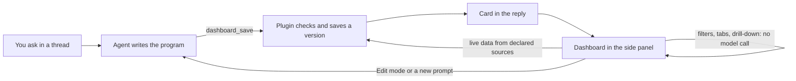

# bb Dashboards

[](https://m8ven.ai/mcp/ahsan7162-bb-plugin-dashboards-1a6os1?s=readme)

A [bb](https://getbb.app) plugin for dashboards you build by asking an agent and keep. The agent writes the dashboard as an [OpenUI Lang](https://www.openui.com) program using OpenUI's dashboard component library; the plugin checks it, saves it as a new version each time, and shows a card in the reply that opens the dashboard in bb's side panel. Filters, tabs, search and drill-down work with no model call. A dashboard can load its own data from a file, the branch's git state and pull request, a read-only tool of an MCP server, or a script you approved, and refresh it without the agent. You change it by asking again, or by pointing at the part you mean.

<!-- VIDEO: open this file in GitHub's web editor and drag your .mp4 onto the line below.
     GitHub uploads it and replaces it with a https://github.com/user-attachments/assets/... link,
     which renders as an inline player. Delete this comment afterwards. -->
<!-- video goes here -->


## What it does

- Turns a prompt such as "build me a dashboard of this week's orders by channel" into a saved dashboard that opens in its own side-panel tab.
- Keeps its versions. "Add a chart by region" or "make it dark green" saves the next version, and the open panel redraws. The newest 100 can be viewed and restored.
- Responds to filters, tabs, search, toggles, sliders and drill-down at once, with no model call.
- Loads live data from files, git, the pull request, MCP connections and approved scripts, and refreshes it without the agent.
- Lists every dashboard on a Dashboards page, so you can reopen one without finding its thread.
- Stays read-only by design: a dashboard has no way to write, and a script source runs only after you read and approve it.

## How it works

1. **Ask.** In any bb thread, ask for something you want to keep: a dashboard, a report, a tracker or a small tool.
2. **Save.** The agent loads the plugin's `dashboards` skill, gathers the data with the tools it has, and calls `dashboard_save`. The plugin checks the whole program; if anything is wrong, nothing is stored and the agent gets the list of problems to fix.
3. **Card.** The reply shows a card with the dashboard's title and "Open in side panel".
4. **Side panel.** The dashboard opens in its own tab in the thread's side panel, drawn with OpenUI's renderer in bb's colours.
5. **Change by asking.** Ask for a change, or use Edit mode to point at a part. The agent sends only the changed statements; the plugin checks and saves them as the next version, and the open panel redraws.
6. **Live data.** Declared sources reload on open, when a filter they read changes, on a timer and on Refresh, through the plugin's server, with no model call. Data only the agent can reach is refreshed by asking the agent, one turn per refresh.



## Features

### Dashboards that open in the side panel

The agent's reply holds a small `bb-dashboard` block with the dashboard's id, which bb draws as a card. "Open in side panel" opens the dashboard in its own tab beside the thread. The header shows the title, how the dashboard refreshes, and the Edit, Colours and version controls. If bb cannot open the side panel where the card is, the card points to the Dashboards page. See [docs/getting-started.md](docs/getting-started.md).


### Changing a dashboard by prompt, and versions

Ask "add a chart by region", "make it dark green" or "mark the third task Done". The agent reads the current program with `dashboard_get` and saves a patch of only the new or changed statements; the plugin merges it, checks the whole program again and saves the next version. The newest 100 versions are kept. Each can be viewed, read-only, from the header's version list, and restored as the new latest version. Your filter choices survive a new version. See [docs/editing.md](docs/editing.md).


### Live data

A dashboard declares named, read-only sources and reads each with a `Query` statement:

- a JSON or CSV file in the thread's folder or its thread storage;
- the branch's commits since its base branch, its changed files, and its pull request with checks and review state, read through bb's built-in Git and pull request plugins;
- a read-only tool of an MCP server you added on the Connections page;
- a script you read and approved, run on your machine;
- data the agent fetches and stores, when nothing else reaches it ("Refresh asks the agent").

All but the last refresh by themselves, every 10 seconds at the shortest, and pause while the tab is hidden. `Freshness` shows when a source last answered; `RefreshButton` refreshes now. See [docs/data-sources.md](docs/data-sources.md), [docs/connections.md](docs/connections.md) and [docs/scripts.md](docs/scripts.md).


### Interactivity without the model

Filters, tabs, search boxes, toggles and sliders set `$variables` that the rest of the program reads, so the dashboard responds at once. Picking an item in a `RecordList` opens its details in a `Drawer`. The panel remembers the choices you made, per dashboard, in your browser. None of this calls the model. See [docs/components.md](docs/components.md#the-drill-down-pattern).


### Edit mode: point at a part and ask for a change

Click Edit in the dashboard's header, then click a chart, card, filter or any other part (or Tab to it and press Enter). A popover shows what you picked, with breadcrumbs, and a box for what should change. Send delivers one message to the thread that names the dashboard, the version, the part and its piece of the program, and asks the agent to change only that. Each Send costs one agent turn. See [docs/editing.md](docs/editing.md#edit-mode).


### Colours and themes

A dashboard follows bb's theme in light and dark mode. Charts start from bb's main colour; when that colour is a neutral grey, as in bb's stock theme, they start from bb's blue accent, then its other accent colours, then OpenUI's palette. The agent can give a dashboard its own theme (colours, radius, spacing and one of three generic fonts), saved as a new version. On top of both, the Colours button lets whoever is looking pick an accent, chart colours (from the accent, or one of two colour-blind-friendly palettes) and a light or dark look for that dashboard. Those choices stay in your browser, cost no model call and make no version. See [docs/themes-and-colours.md](docs/themes-and-colours.md).


### The Dashboards page

A page in bb's navigation lists every dashboard, last changed first, with its number of versions and a link to the thread it was made in. Open one there, or delete it with all its versions. The page's Connections section manages the plugin's MCP connections. See [docs/getting-started.md](docs/getting-started.md#reopening-a-dashboard).


### Working alongside inline-reply UI plugins

Some bb plugins let an agent draw charts and tables inline in a reply. The `dashboards` skill draws the line: what you want to keep, reopen, change later or have refreshed becomes a dashboard; a chart that only answers the current message stays in the reply. One reply can hold both, and a change to something already saved as a dashboard changes the dashboard instead of drawing a new inline chart. This was checked in real threads with both kinds of plugin installed. See [docs/agents.md](docs/agents.md#working-alongside-inline-reply-ui-plugins).


## Components

62 components: the 45 of OpenUI's dashboard library, and 17 of the plugin's own. Full signatures are in [docs/components.md](docs/components.md).

| Group | Component | What it does |
| --- | --- | --- |
| Structure | Dashboard | The root. |
| Structure | Section | A titled group of KPI strips and rows of cards. |
| Structure | Row | Cards side by side on a 12-column grid, all the same height. |
| Structure | Card | A titled box holding one visual, with optional width, subtitle and its own filters. |
| Filters | FilterBar | Sticky row of dashboard-wide filters. |
| Filters | PeriodPicker | Segmented control for a few date presets. |
| Filters | DateRangeFilter | Date presets plus a calendar for a custom range. |
| Filters | ChipFilter | Pills for 2 to 6 segments. |
| Filters | SelectFilter | Dropdown for one value from a longer list. |
| Filters | MultiSelectFilter | Dropdown with checkboxes for several values. |
| Filters | CompareToggle | Overlays previous-period data on every chart that has it. |
| Metrics | Kpis | A strip of KPI tiles that lays itself out. |
| Metrics | Kpi | One tile: a number with its change, or a short status text. |
| Metrics | Trend | A Kpi's sparkline. |
| Metrics | Progress | A Kpi's progress toward a target. |
| Metrics | Split | What a Kpi's total is made of, up to 3 parts. |
| Metrics | States | A Kpi's status strip, one dot per period. |
| Metrics | Stat | A headline number at the top of a Card. |
| Metrics | KeyValues | Label and value fact rows. |
| Metrics | KeyValue | One row of KeyValues. |
| Metrics | Goal | Progress toward a target, with pace. |
| Tables | Table | Sortable, paged table with totals, search and grouping. |
| Tables | Column | One column; its kind decides how cells draw. |
| Trends | TimeSeries | A metric over time as line, area or bars. |
| Trends | Series | One series of a chart. |
| Trends | Reference | A target or limit line. |
| Trends | Marker | An event on the time axis. |
| Trends | SmallMultiples | A grid of small charts on one scale. |
| Trends | StatusTimeline | Up, degraded or down per service over time. |
| Comparison | Bars | Values across categories. |
| Comparison | Leaderboard | A ranked list with inline bars. |
| Comparison | Dumbbell | Two values per category joined by a line. |
| Comparison | Distribution | One box plot per category. |
| Comparison | Intervals | Estimates with confidence intervals. |
| Composition | Donut | Part of a whole with the total as headline. |
| Composition | SegmentedBar | Part of a whole as one bar. |
| Composition | Treemap | Many or nested parts as rectangles. |
| Composition | Waterfall | How a total moved through signed changes. |
| Flow | Funnel | Ordered conversion steps with drop-off. |
| Flow | Flow | A Sankey diagram between stages. |
| Relationships | Scatter | Two measures per item. |
| Relationships | Heatmap | Magnitude across two categories. |
| Relationships | Cohorts | A retention grid. |
| Maps | GeoMap | Values by country or US state. |
| Maps | PointMap | Values at places as sized circles. |
| Plugin: views | Tabs | Several views in one Section. |
| Plugin: views | Tab | One view of Tabs. |
| Plugin: views | Drawer | A details panel, shown in place while its `$variable` is set. |
| Plugin: views | RecordList | Items from a system; picking one writes its id to a `$variable`. |
| Plugin: views | Record | One item of a RecordList. |
| Plugin: views | SearchBox | A text box for filtering. |
| Plugin: views | Toggle | An on/off view option. |
| Plugin: views | Slider | A number the user drags. |
| Plugin: views | Badge | A coloured status word. |
| Plugin: views | LinkOut | A link that opens an `http` or `https` address. |
| Plugin: views | Markdown | Written explanation between charts. |
| Plugin: views | Callout | A highlighted note. |
| Plugin: views | Empty | What to show when there is nothing to show. |
| Plugin: views | AskAgent | A button that asks the agent about the dashboard (one model turn). |
| Plugin: free content | Frame | Free HTML, CSS and JS in a sandbox with no network. |
| Plugin: live data | Freshness | When a source last answered and how it refreshes. |
| Plugin: live data | RefreshButton | Refreshes every source, or one, now. |

## Use cases

Invented examples, each with the prompt one would type.

- **Reviewing your own branch.** "Make a dashboard for this branch: its pull request with checks and review state, the commits since main and the changed files with lines added and removed. Keep it refreshing." The dashboard reads the `pull_request`, `git_commits` and `git_changes` sources and refreshes itself while you work.
- **A benchmark or test run.** "Read bench/results.json from the last benchmark run and build a dashboard comparing p50 and p95 latency per endpoint with the previous run, worst regressions first." A `file` source; each new run that rewrites the file shows on the next refresh.
- **Incidents from a connected system.** After adding an invented help-desk server on the Connections page and confirming its read-only tools: "Using the helpdesk connection, build an incident board: open incidents by severity, a list I can click for details, and a link to each one." An `mcp` source refreshes on a timer with no model call; a `RecordList` and a `Drawer` give the drill-down.
- **A weekly numbers report.** "Each Monday I save the shop's weekly sales to exports/weekly.csv. Build a report with revenue, orders and refunds against the previous week, and a chart by product." A CSV `file` source arrives as rows keyed by the header.
- **A what-if tool.** "Build a small pricing tool for a café: sliders for the price of a coffee, cups sold per day and monthly rent, showing monthly profit and how many cups a day it takes to break even." No data source at all: `Slider`s set `$variables` and the numbers are computed in the program.
- **A command-line tool with no MCP server.** "There's no connection for the job queue tool. Write a script source that lists open jobs per state with the read-only token, and I'll approve it." The script waits for your approval in the panel and runs only after you have read it.

## Why it is relevant

What it replaces:

- Asking the agent the same question again each day, at the cost of a model turn and the time to rebuild the answer.
- One-off charts that scroll away in a long thread and cannot be refreshed or changed later.

What makes it different:

- **Checked, declarative programs instead of free HTML.** A dashboard is an OpenUI Lang program. Before it is stored, the plugin checks that it parses, that every component sits where its parent allows, that every `Query` names a declared source, that links are `http` or `https`, and that it contains no `Mutation`. Programs are parsed and drawn by OpenUI's renderer, never run as JavaScript. Free code is possible only inside a `Frame`, which is sandboxed with no network.
- **No model call to view or refresh.** Opening, filtering, drilling down, switching versions, changing colours and refreshing file, git, pull request, MCP and approved-script sources all happen without the model. Only changes, AskAgent buttons and agent-source refreshes cost a turn.
- **Read-only by design.** Each path has its own guard: no `Mutation`, fixed read functions for built-in sources, only confirmed read-only MCP tools, a sandboxed frame, and an approval dialog for scripts. See [docs/security-and-privacy.md](docs/security-and-privacy.md).

## Safety and privacy

In brief; the full page is [docs/security-and-privacy.md](docs/security-and-privacy.md).

- **Read-only.** A program cannot write; MCP tools are callable only when the server marks them read-only and you confirmed them; built-in sources use fixed read functions; the `Frame` has no network.
- **What runs where.** The save check, source reads, MCP connections and scripts run in bb's server on your machine. The browser only draws, and gets data only by naming a declared source.
- **Secrets** (tokens, secret variables and headers, script secrets) are kept in the operating system's secure store under the service `bb-dashboards`, passed on standard input, never shown to the page or the agent. A web connection needs `https` (plain `http` only on this machine). Only macOS has been tested.
- **Callers.** Other plugins are refused on every function the plugin offers. bb's app, its command line and agents cannot be told apart, so all three are accepted.
- **Scripts** run only after you approve the exact text in a dialog that warns, shows the whole script, flags risky lines and keeps Approve off until you have read to the end. Its stated limit: bb cannot tell the plugin's page from bb's command line, so an agent you allow to run shell commands could approve a script without the dialog, and could also run commands directly. An approved script is not sandboxed.
- **Stored locally.** Dashboards, versions, agent data, connection records and approvals in the plugin's own database; remembered choices and Colours in your browser's local storage; secrets in the secure store. Nothing is sent to the plugin's author.
- **Telemetry.** The plugin has none of its own. OpenUI's `@openuidev/lang-core` has a runtime usage report that stays off unless the machine's owner sets `OPENUI_RUNTIME_TELEMETRY_ENABLED` (and `DO_NOT_TRACK=1` overrides it); its install-time report runs from an npm install script, which bb's git install and this repository both turn off.

## Requirements

- bb 0.49 or later (plugin SDK 0.6.132 or later).
- An agent provider in bb. Only the Claude Code provider has been tried.
- For git and pull request sources: bb's built-in Git and GitHub pull request status plugins.
- For connections with secrets: a working secure store on the machine bb's server runs on (tested on macOS only).
- For scripts: macOS (Linux is supported by the code but untested; Windows is not supported), the thread's environment on the machine bb's server runs on, and `sh`, `bash`, `python3` or `node` on bb's tool path.

## Install

From a local checkout:

```sh
cd bb-plugin-dashboards
npm ci                # install scripts stay off (.npmrc)
bb plugin install .   # bb builds and registers the plugin
```

From git:

```sh
bb plugin install git:https://github.com/ahsan7162/bb-plugin-dashboards.git@main
```

Installing from git has not been tested yet.

## Quick start

Try these three prompts in a bb thread:

1. "Build me a dashboard of this week's orders by channel for a small online bakery, with made-up numbers." Then click "Open in side panel" on the card.
2. "Add a chart of orders by day, and make it dark green." The open panel redraws with the change as a new version; the earlier one stays in the version list.
3. "Make a dashboard of the files changed on this branch and its pull request checks, and keep it refreshing." (In a thread whose environment is a git checkout.)

More in [docs/getting-started.md](docs/getting-started.md).

## Limits and known gaps

The full list is [docs/limits.md](docs/limits.md). The main ones:

- Tested in the real app on macOS with the Claude Code provider only. Windows and Linux, other providers, and installing from git or a marketplace are untested.
- Windows and Linux secure stores are checked only by the exact commands they would run. Scripts are not supported on Windows.
- Approving and then running a script was never clicked through in the real app; it is covered by tests.
- Not supported: writing anywhere, exporting or sharing a dashboard, refreshing while no one has it open, browser sign-in (OAuth) or SSE for connections, using the agent's own MCP connectors, clicking a library chart or table row.
- Only the newest 100 versions of a dashboard are kept; a restored version shows the latest stored agent data, which is not versioned.
- An approved script is not sandboxed, an MCP server's read-only mark is its own claim, and an agent allowed to run shell commands can do what the Dashboards page does.
- No capture of real network traffic was made; the no-network claims come from tests.

## Development

```sh
npm run setup       # npm ci with install scripts off, then better-sqlite3 for the tests
npm test            # bb plugin build, then every test
npm run typecheck   # tsc --noEmit
npm run build       # bb plugin build
npm run generate    # rewrite server/generated.ts and skills/dashboards/SKILL.md from the library
```

- **Install scripts are off** (`.npmrc`), because `@openuidev/lang-core`'s install script reports usage over the network. `npm run setup` rebuilds only `better-sqlite3`, which the tests need.
- **The katex stand-in.** OpenUI's components depend on the `katex` math renderer, whose CSS names 60 font files `bb plugin build` cannot load. Dashboards never draw math, so an npm override replaces it with an empty package in `stubs/katex`.
- **The generator** builds the agent's guide, topics and the save check's schema from the component library, so they cannot drift apart; a test fails while they are stale.

More in [docs/development.md](docs/development.md) and [docs/architecture.md](docs/architecture.md).

## Documentation

| Page | What it covers |
| --- | --- |
| [Getting started](docs/getting-started.md) | Install, first dashboard, the edit loop, reopening |
| [Components](docs/components.md) | Every component with its signature; drill-down; an example |
| [Data sources](docs/data-sources.md) | Declared sources, each kind, refresh, failures |
| [Connections](docs/connections.md) | The plugin's own MCP connections |
| [Scripts](docs/scripts.md) | Script sources and the approval dialog |
| [Themes and colours](docs/themes-and-colours.md) | bb's theme, dashboard themes, the Colours control |
| [Editing](docs/editing.md) | Changing by prompt, versions, Edit mode |
| [What the agent sees](docs/agents.md) | The skill, the tools, topics, the save check |
| [Security and privacy](docs/security-and-privacy.md) | The read-only model, secrets, storage, callers, telemetry |
| [Architecture](docs/architecture.md) | Server, browser, storage, rendering, repository layout |
| [Limits](docs/limits.md) | Every known limit and untested area |
| [Development](docs/development.md) | Setup, tests, the generator, release checklist |

## Licence and credits

MIT. See [LICENSE](LICENSE).

Dashboards are written in [OpenUI Lang](https://www.openui.com) and drawn with OpenUI's packages: the dashboard component library (`@openuidev/dashboard-library`), the React renderer (`@openuidev/react-lang`) and the language core (`@openuidev/lang-core`), all MIT. Thanks to the OpenUI project for the language and the 45 dashboard components. MCP connections use the Model Context Protocol TypeScript SDK (`@modelcontextprotocol/sdk`, MIT); input checks use `zod` (MIT).
