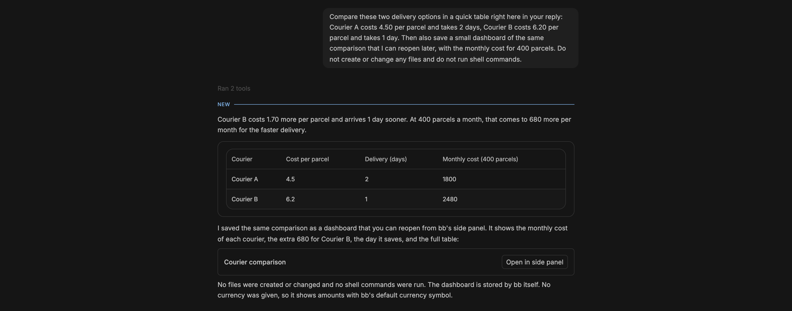

# What the agent sees

This page is for people who want to know exactly what bb Dashboards puts in front of an agent. The plugin adds one skill, `dashboards`, whose short description is the only text about the plugin that is always present; the skill's body (the authoring guide) loads only when the agent decides it needs it. It adds three tools, `dashboard_save`, `dashboard_get` and `dashboard_sources`, with short definitions. Details such as chart signatures, live data and themes are topics the agent fetches only when a dashboard needs them. Every save goes through a strict check on the server. The token figures at the end were measured with the Claude Code provider only.

## Always present

- The skill's description, which decides when an agent loads the skill:

  > Use when the user wants to keep, reopen, come back to or change later what they ask for, or wants it to refresh: a dashboard, report, tracker or small tool, saved as a dashboard that opens in bb's side panel. A chart or table that only answers the current message stays in the reply.

- The three tools. Whether their full definitions are sent with every request or only when the agent first needs them depends on the provider.
- No always-on instructions: the plugin registers no instruction text of its own.
- The tools and the skill are offered in every thread: threads a person started, forks, helper (worker) threads and threads another plugin runs. A dashboard made in a helper thread stays refreshable and changeable from there.

## The skill: `dashboards`

The skill's body is the core authoring guide, about 10,500 characters. It holds:

- what a dashboard is, and how to save and change one;
- OpenUI Lang in brief: statements, expressions, `$variables` and operators;
- the four layout components (`Dashboard`, `Section`, `Row`, `Card`) and the shared argument types;
- the built-in functions (`@Count`, `@Filter`, `@Each` and the rest);
- the rules every program needs;
- "Read-only and safe": the dashboard only shows data, every source is read with its own `Query`, links open only `http` and `https`, no secret goes into a program, and the agent cannot add a connection or approve a script;
- how to answer when the chat can also draw inline UI (below);
- one example with invented data, a "Before you save" checklist, and the list of topics.

The guide is generated by `scripts/generate.ts` from OpenUI's dashboard library prompt, condensed. Three of the library's stock rules are dropped (they forbid tabs, text blocks and refresh buttons, or teach `Query` against a generic data tool), and its example that queries SQL is not used. The generator fails when the library's stock text changes, so an upgrade is reviewed by hand. The same text is what `dashboard_get` returns with no arguments, for providers without skills.

## The three tools

Each tool's description ends with: `Load the dashboards skill first (without skills: dashboard_get topic "guide").`

| Tool | What it does | Parameters |
| --- | --- | --- |
| `dashboard_save` | Checks and saves a dashboard; returns the card block for the reply. Creates (title and program) or changes (id and a patch, program, title, theme or sources), each change a new version. With only id and data, stores agent-source results without a version. | `id`, `title`, `program`, `patch`, `theme`, `sources`, `data` |
| `dashboard_get` | No arguments: the guide. `topic`: a detail topic. `components`: the signatures of 1 to 20 named components. `id`: a dashboard's current program, theme and sources, for editing. | `topic`, `components`, `id` |
| `dashboard_sources` | No arguments: every source kind with its declaration, arguments and an invented sample result, and the user's connections with their confirmed read-only tools. With `kind` (and `path`, `root` for a file) it runs that source once for the current thread; with `connection` and `tool` it runs that tool once. Every answer is cut at 6,000 characters. It never runs a script. | `kind`, `path`, `root`, `args`, `connection`, `tool` |

`dashboard_save` advertises only a loose outline of its parameters; the server checks the full shapes and, on a mistake, names the topic that has them.

### What the agent gets back

- On success: `Saved "<title>" as dashboard <id>, version <n>.` and the card block to put in the reply exactly as written:

  ````text
  ```bb-dashboard
  3f9a1c07b2de
  ```
  ````

  bb draws that block as a card with the dashboard's title and an "Open in side panel" button. While the reply is still streaming, or when the block's body is not a dashboard id, it shows as an ordinary code block.
- When the dashboard has agent sources and the plugin holds connections with confirmed tools: a note that an `mcp` source might refresh without the agent, and that nothing was switched.
- When the dashboard declares scripts: which wait for approval, which kept it, which cannot run on this machine, which secret values the user enters in the panel, and that the agent can never approve a script by any route.
- On failure: `Not saved. Fix these and save again:` followed by every problem as a sentence. Nothing is stored.

### What the agent never sees

- A connection's command, address, variables or secrets. It sees only the connection's name, its kind (local command or web server) and its confirmed tools with their descriptions and input schemas.
- Any secret value, or a script's error output.
- The agent has no tool that adds, changes or removes a connection, confirms a tool, approves a script or deletes a dashboard.

## Topics on demand

`dashboard_get` with `topic` returns one of these. Sizes are in characters, as generated today.

| Topic | What it covers | Size |
| --- | --- | --- |
| `guide` | The core guide (the skill's body) | about 10,500 |
| `filters` | FilterBar and the six filters, when to use which | about 6,200 |
| `metrics` | Kpis, Kpi, Trend, Progress, Split, States, Stat, KeyValues, KeyValue, Goal | about 3,200 |
| `tables` | Table and Column | about 1,600 |
| `trends` | TimeSeries, Series, Reference, Marker, SmallMultiples, StatusTimeline | about 2,600 |
| `comparison` | Bars, Leaderboard, Dumbbell, Distribution, Intervals | about 3,400 |
| `composition` | Donut, SegmentedBar, Treemap, Waterfall | about 3,500 |
| `flow` | Funnel, Flow | about 1,600 |
| `relationships` | Scatter, Heatmap, Cohorts | about 2,500 |
| `maps` | GeoMap, PointMap | about 1,300 |
| `views` | The plugin's own components for tabs, drill-down, search and notes, with an example | about 8,400 |
| `frame` | Frame: free HTML, CSS and JS in a sandbox | about 1,800 |
| `live-data` | Declaring sources, `Query`, Freshness and RefreshButton | about 4,600 |
| `mcp` | Sources from the user's MCP connections | about 900 |
| `scripts` | Script sources and why only the user approves them | about 3,000 |
| `themes` | A dashboard's own colours, radius, spacing and font | about 1,600 |

Every example in the guide and its topics uses invented shops, services and numbers.

## The save check

Every save is checked on the whole program, after a patch is merged. Any failure goes back to the agent as a list of sentences, and nothing is stored.

Input:

- An id is 12 characters of `0-9` and `a-f`. A title is 1 to 120 characters. A program (after merging) is at most 100,000 characters.
- Creating needs a title and a program, and no patch. Changing needs an id and either a program or a patch, not both.

Program (`server/validate.ts`):

1. It parses with no errors, is not cut off, uses no undefined names, and every statement is reached from the root.
2. The root statement is `root = Dashboard(...)`.
3. Every component sits where its parent allows (OpenUI's parser does not check this, so the plugin does), including components written inside a ternary or an `@Each` template.
4. A written-in link in `LinkOut` or a `Record` is `http` or `https`.
5. It contains no `Mutation`, in any form. Dashboards are read-only.
6. Every `Query` is a whole top-level statement, `name = Query("source", ...)`, naming a declared source.
7. A `Query`'s refresh interval, when given, is a number written in and at least 10 seconds (30 for a script source).
8. It contains no OpenUI protocol marker (`]]>openui:`), which could make the renderer show text the check never saw.

Sources and data:

- At most 12 sources, each name used once; each source's own shape (see [data-sources.md](data-sources.md) and [scripts.md](scripts.md)).
- An `mcp` source names an existing connection and one of its confirmed tools, checked when the sources are given.
- `data` goes only to declared agent sources, at most 256 KB each.

Theme: only the 88 token names, values without `url(`, and one of three fonts (see [themes-and-colours.md](themes-and-colours.md)).

Known gaps: OpenUI's parser accepts a little malformed text without reporting it (a stray line, an extra closing bracket), and a component reached through a name inside a ternary or `@Each` is not checked for where it sits. The real-app checks recorded during development (Claude Code provider) report agents' builds passing on their first save; this was not measured systematically.

## Working alongside inline-reply UI plugins

Some bb plugins let an agent draw UI inline in its reply, for example as `openui-lang` blocks. The skill's description draws the line between the two: what the user wants to keep, reopen, change later or have refreshed becomes a dashboard; a chart or table that only answers the current message stays in the reply. The guide adds:

- The dashboard's card is its own code block with the language `bb-dashboard`, exactly as `dashboard_save` returns it, never inside an `openui-lang` block.
- The reply may sum up in plain text or a small inline block, but does not repeat the whole dashboard inline.
- A request to change something already saved as a dashboard changes the dashboard instead of drawing a new inline chart.

Checked in real threads with both kinds of plugin installed (Claude Code provider): a request for "something I can come back to next week and change" became a dashboard; a helper thread built a tracker as a dashboard; "a quick bar chart" stayed inline; a request for both gave an inline table and a dashboard card in one reply; "change Feb to 140" and "mark the third task Done" each changed the saved dashboard as version 2, with no new inline chart.

<!-- SCREENSHOT inline-and-dashboard-dark.png (the picture is ready at screenshots/inline-and-dashboard-dark.png): one agent reply, dark mode, holding both an inline table drawn in the reply and a dashboard card. The dashboard is not open beside it. Rules for a replacement: about 1,580 px wide (at least 1,200), PNG under 2 MiB, stock bb theme, invented data only, no thread list or project name. To show it, add this line here:  and, if you want it, this caption on its own line: *An inline table answers the question; the card keeps the dashboard.* -->

## Related pages

- [components.md](components.md): the signatures the agent fetches.
- [data-sources.md](data-sources.md): what `dashboard_sources` describes.
- [security-and-privacy.md](security-and-privacy.md): what the agent can and cannot reach.
- [limits.md](limits.md#where-it-was-tested): untested providers.
