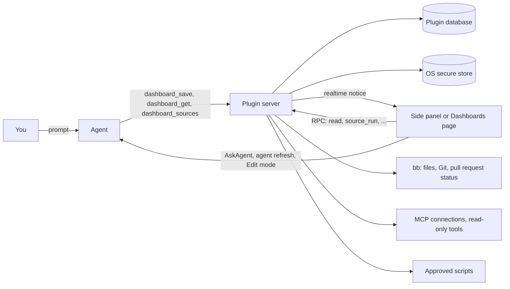

# Architecture

bb Dashboards has two halves. The server half runs inside bb's server: it holds the agent tools, the save check, the plugin's SQLite database, the source readers, the MCP client and the script runner, and it talks to the operating system's secure store. The browser half runs in bb's window: it draws the card in a reply, the dashboard in a side-panel tab and the Dashboards page, renders programs with OpenUI's React renderer, and asks the server for data through one function, `source_run`. The two halves share a few constants and nothing else. Some server files are generated from the browser's component library. This page describes each part, the rendering path, realtime updates, the generated files and the repository layout.

## Overview



## Server

| File | What it does |
| --- | --- |
| `server.ts` | The plugin factory: opens the store, the secure store, connections and scripts, registers the agent tools and the RPC functions the browser calls, and refuses other plugins on every function. |
| `server/tools.ts` | The three agent tools and the agent configuration that offers them and the skill in every thread. |
| `server/validate.ts` | The save check on a whole program. |
| `server/store.ts` | The plugin's SQLite database and its migrations (append-only); keeps the newest 100 versions of each dashboard. |
| `server/theme.ts` | The shape of a dashboard's theme. |
| `server/sources.ts` | Source declarations and their arguments, the file, git and pull request readers, the CSV parser, and the source help the agent reads. |
| `server/run.ts` | `source_run`: looks up the declaration, checks arguments, applies the refresh floor, the cache and the rate limit, and sends the run to the right reader. |
| `server/connections.ts` | The plugin's MCP connections: records, secrets, open clients, the read-only filter. |
| `server/mcp.ts` | The MCP client side: starting a local server with an exact environment, reaching a web server, listing tools, reading results. |
| `server/discover.ts` | "Find existing servers" and importing one. |
| `server/secrets.ts` | The secure store through each system's own tool. |
| `server/scripts.ts` | Script approvals, script secrets and the script runner. |
| `server/generated.ts` | Generated: the parser schema, the guide, topics, signatures and theme token names. |
| `shared.ts` | Constants used by both halves: realtime channel names, the card's block language, the script refresh floor, the id check and the font choices. It imports nothing. |

The server imports only `server/generated.ts` and OpenUI's `@openuidev/lang-core` from the component side, so it never loads React.

RPC functions (17): `read`, `list`, `delete`, `restore`, `source_run`, `scripts`, `script_approve`, `script_withdraw`, `script_secret`, `connections_list`, `connection_add`, `connection_secret`, `connection_check`, `connection_confirm`, `connection_remove`, `discover`, `discover_import`. Each checks its input with a strict schema. Who may call which is in [security-and-privacy.md](security-and-privacy.md#who-can-call-the-plugins-functions).

## Browser

| File | What it does |
| --- | --- |
| `app.tsx` | Registers the three surfaces: the side-panel tab, the renderer for `bb-dashboard` blocks, and the Dashboards page. |
| `ui/card.tsx` | The card in a reply: the dashboard's title and "Open in side panel". If bb declines to open the panel, it points to the Dashboards page. |
| `ui/panel.tsx` | One dashboard's view, shared by the tab and the page: loading, the version list and restoring, theme layers, remembered choices, the two actions a program may raise, script notices and the header controls. |
| `ui/live.tsx` | Live data: one function per declared source, the pause while the tab is hidden, and the re-run hook. |
| `ui/library.tsx` | The component library: OpenUI's dashboard library extended with the plugin's own components. |
| `ui/components/` | The plugin's 17 components and their styles. |
| `ui/gallery.tsx` | The Dashboards page and its Connections section switch. |
| `ui/connections.tsx` | The Connections section. |
| `ui/scripts.tsx`, `ui/flags.ts` | The approval dialog, its flagged-line patterns, script notices and the "Runs a script" badge. |
| `ui/colours.tsx` | The viewer's Colours control and its colour maths. |
| `ui/edit.tsx` | Edit mode: finding parts, placing them in the program, and the change message. |

## Storage

- The plugin's database is bb's per-plugin SQLite database. Its tables hold dashboards, versions, agent data, connections, script approvals and script secret names; never a secret value. Migrations are append-only.
- The browser's local storage holds remembered `$variable` values and Colours choices, per dashboard.
- The operating system's secure store holds secret values, under the service `bb-dashboards`.

Details in [security-and-privacy.md](security-and-privacy.md#what-is-stored-where).

## The rendering path

1. The card or the Dashboards page opens the dashboard view with an id.
2. The view calls `read` for the latest version (or a chosen older one) and every kept version's number.
3. It parses the program in the browser with OpenUI's streaming parser, only to learn the `$variable` defaults and the `Query` statements.
4. It renders the program with OpenUI's `Renderer`, the plugin's library (each component wrapped so Edit mode can find it), and:
   - a `ThemeProvider` with bb's mapping, the dashboard's theme and the viewer's Colours, for each mode;
   - `initialState`: the remembered values that still fit the program's defaults;
   - a `toolProvider`: one function per declared source, each calling `source_run` for the shown version;
   - an action handler that accepts only two kinds: opening an `http` or `https` link, and sending a message to the thread. Every other action is ignored.
5. Queries run on open, when their arguments change, on their timer and on Refresh, and answer from their last result while the tab is hidden.

A new version of the dashboard redraws in the same renderer, so filter choices and live state are kept. A viewer's colour change re-renders with the same key and the same data, so nothing restarts and nothing is fetched again.

## Realtime

- Each save, and each restore of an old version, publishes the dashboard's id and new version on one realtime channel; storing agent data publishes the id and the source names on another, without a new version.
- An open view of that dashboard loads it again, or re-runs the queries that read those sources. The Dashboards page reloads its list.
- Notices carry only ids, a version number and source names. They are not replayed if missed, so a view loads again whenever its realtime connection returns.

## Generated files

`scripts/generate.ts` writes `server/generated.ts` and the skill file `skills/dashboards/SKILL.md` from the merged library in `ui/library.tsx`:

- the parser schema the save check uses, and the root name;
- the core guide (the skill's body) and the detail topics, condensed from OpenUI's library prompt with the plugin's own sections;
- one signature line per component, and the 88 theme token names.

It loads `ui/library.tsx` through Vite's module runner, because plain Node loads neither `.tsx` nor CSS. Run `npm run generate` after upgrading `@openuidev/*` or editing a component or the guide's text; a test fails while either generated file is stale. See [development.md](development.md#the-generator).

## Repository layout

```text
app.tsx                 browser entry: the tab, the card renderer and the Dashboards page
server.ts               server entry: store, tools, RPC functions
shared.ts               constants used by both halves
server/                 server modules and their tests; generated.ts is generated
ui/                     browser modules and their tests
ui/components/          the plugin's own components and styles.css
scripts/generate.ts     writes server/generated.ts and the skill
skills/dashboards/      SKILL.md, generated
stubs/katex/            empty stand-in for katex (see development.md)
test/                   the fake bb host, test setup and an invented MCP server
spikes/                 early experiments, kept for reference; not part of the build or the tests
build.test.ts           checks on the built bundles in dist/
docs/                   this documentation
dist/                   build output, not committed
```

## Related pages

- [data-sources.md](data-sources.md): what `source_run` reads.
- [security-and-privacy.md](security-and-privacy.md): what each part may do.
- [development.md](development.md): building, testing and generating.
