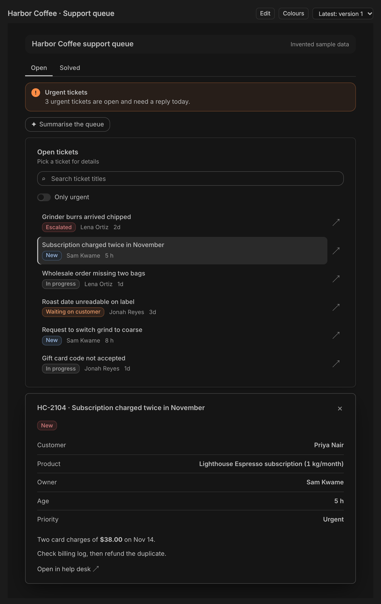

# Components

A dashboard is one [OpenUI Lang](https://www.openui.com) program whose root is `Dashboard`. It can use 62 components: the 45 of OpenUI's dashboard component library (`@openuidev/dashboard-library`, MIT), with their props unchanged, and 17 that this plugin adds for tabs, drill-down, search, notes, free-form content and live data. This page lists every one with its signature, as the agent sees it, and a one-line purpose. Signatures here are copied from the plugin's generated file (`server/generated.ts`), which is built from the merged library by `npm run generate`.

<!-- SCREENSHOT components-dark.png (the picture is ready at screenshots/components-dark.png): a support queue dashboard, dark mode: Tabs (Open, Solved), a warning Callout, an AskAgent button, a SearchBox, a Toggle, a RecordList with status Badges and one record picked, and that record's details Drawer with key-values, Markdown notes and a LinkOut. Rules for a replacement: about 1,580 px wide (at least 1,200), PNG under 2 MiB, stock bb theme, invented data only, no thread list or project name. To show it, add this line here:  and, if you want it, this caption on its own line: *The plugin's own components: tabs, a callout, AskAgent, search, a toggle, a record list and the drawer for the picked record.* -->

How to read a signature:

- Arguments are positional. `?` marks an optional one; pass `null` to skip an optional argument before one you need.
- `$binding<type>` takes a `$variable`, which the component reads and writes. That is how filters, tabs and inputs change what other components show, without a model call.
- Three argument types are shared:
  - `Format` = `"number" | "compact" | "currency" | "currency-compact" | "currency-precise" | "percent" | "ratio" | "multiplier" | "duration" | "ms" | "days"`, or `{type, currency?, decimals?, prefix?, suffix?}` to override, for example `{type: "number", suffix: " seats"}`.
  - `Width` = `"quarter" | "third" | "half" | "two-thirds" | "three-quarters" | "full"`.
  - `GoodWhen` = `"up" | "down" | "neutral"`: which direction of change is good news.

Where things go: `Dashboard` holds an optional `FilterBar` first, then `Section`s. A `Section` holds `Kpis` strips, `Row`s and the plugin's full-width components. A `Row` holds `Card`s only. Every chart, map, `Table`, `Stat`, `Goal` and `KeyValues` goes inside a `Card`. The save check refuses a component placed anywhere its parent does not allow (see [agents.md](agents.md#the-save-check)).

## OpenUI's dashboard library (45)

### Structure

| Component | Purpose |
| --- | --- |
| Dashboard | The root. |
| Section | A titled group of KPI strips and rows of cards; `""` as title for the lead KPI section. |
| Row | Cards side by side on a 12-column grid, all the same height. |
| Card | A titled box holding one visual (often with a `Stat` above it), with optional width, subtitle and its own filter controls. |

```text
Dashboard(children: (FilterBar | Section)[])
Section(title: string, rows: (Kpis | Row | Tabs | Drawer | SearchBox | Toggle | Slider | Markdown | Callout | Empty | Frame | AskAgent | Freshness | RefreshButton)[], description?: string)
Row(items: Card[], height?: 240 | 320 | 400 | 480 | 560 | 640)
Card(title: string, content: (Stat | TimeSeries | SmallMultiples | Bars | Dumbbell | Distribution | Donut | Treemap | Waterfall | Intervals | StatusTimeline | Flow | Scatter | GeoMap | PointMap | Funnel | Cohorts | Heatmap | Table | Leaderboard | Goal | SegmentedBar | KeyValues | Drawer | SearchBox | Toggle | Slider | Markdown | Callout | Empty | Frame | AskAgent | Freshness | RefreshButton | RecordList | Badge | LinkOut)[], width?: Width, subtitle?: string, controls?: (ChipFilter | SelectFilter)[])
```

### Filters

| Component | Purpose |
| --- | --- |
| FilterBar | Sticky row of dashboard-wide filters at the top. |
| PeriodPicker | Segmented control for a few date presets such as 7D and 30D. |
| DateRangeFilter | Dropdown of date presets plus a calendar for a custom range. |
| ChipFilter | Pills for 2 to 6 segments, one always selected. |
| SelectFilter | Dropdown for one value out of a longer list. |
| MultiSelectFilter | Dropdown with checkboxes for several values. |
| CompareToggle | Overlays previous-period data on every chart that has it. |

```text
FilterBar(filters: (PeriodPicker | DateRangeFilter | ChipFilter | SelectFilter | MultiSelectFilter | CompareToggle)[])
PeriodPicker(value: $binding<string>, options: {value: string, label?: string}[])
DateRangeFilter(value: $binding<string>, options?: {value: string, label?: string}[], label?: string)
ChipFilter(value: $binding<string>, options: {value: string, label?: string}[], label?: string)
SelectFilter(value: $binding<string>, options: {value: string, label?: string}[], label: string)
MultiSelectFilter(value: $binding<string[]>, options: {value: string, label?: string}[], label: string)
CompareToggle(label?: string, defaultOn?: boolean, value?: $binding<string>, options?: {value: string, label?: string}[])
```

### Metrics

| Component | Purpose |
| --- | --- |
| Kpis | A strip of KPI tiles that lays itself out, up to 6 per row. |
| Kpi | One stat tile: a number with its change against the previous period, or a short text with a status dot. |
| Trend | A Kpi's sparkline. |
| Progress | A Kpi's progress toward a target. |
| Split | What a Kpi's total is made of, up to 3 parts. |
| States | A Kpi's status strip, one dot per period. |
| Stat | A headline number at the top of a Card. |
| KeyValues | Label and value fact rows. |
| KeyValue | One row of KeyValues. |
| Goal | Progress toward a target, with pace; several stack in one Card. |

```text
Kpis(items: Kpi[])
Kpi(label: string, value?: number | string, format?: Format, previous?: number, goodWhen?: GoodWhen, hint?: string, chart?: Trend | Progress | Split | States, tone?: "good" | "bad" | "warning" | "info" | "neutral")
Trend(values: number[], previous?: number[])
Progress(target: number)
Split(labels: string[], values: number[])
States(states: ("good" | "warning" | "bad" | null)[])
Stat(value?: number, format?: Format, previous?: number, goodWhen?: GoodWhen, label?: string)
KeyValues(rows: KeyValue[])
KeyValue(label: string, value: number | string, format?: Format, previous?: number, goodWhen?: GoodWhen)
Goal(label: string, value: number, target: number, format?: Format, pace?: number, goodWhen?: GoodWhen, previous?: number)
```

### Tables

| Component | Purpose |
| --- | --- |
| Table | Sortable, paged table with optional totals row, search text and grouping. |
| Column | One column; its kind decides how cells draw (number, bar, delta, badge, sparkline, chip, date, progress, states, link, person and more). |

```text
Table(columns: Column[], pageSize?: number, totals?: boolean, search?: string, groupBy?: string)
Column(label: string, values: (string | number | null | number[] | string[])[], kind?: "text" | "primary" | "number" | "bar" | "delta" | "badge" | "sparkline" | "chip" | "date" | "progress" | "states" | "link" | "person", format?: Format, tones?: Record<string, "good" | "bad" | "warning" | "info" | "neutral">, goodWhen?: GoodWhen, total?: "sum" | "average")
```

### Trends

| Component | Purpose |
| --- | --- |
| TimeSeries | A metric over time as line, area or bars, with targets, event markers and a forecast. |
| Series | One series of a chart, with optional previous values and a shaded band. |
| Reference | A target or limit line. |
| Marker | An event on a TimeSeries' time axis, such as a deploy. |
| SmallMultiples | A grid of small charts on one shared scale. |
| StatusTimeline | Up, degraded or down per service over time. |

```text
TimeSeries(labels: string[], series: Series[], type?: "line" | "area" | "bar", format?: Format, stacked?: boolean | "percent", references?: Reference[], goodWhen?: GoodWhen, markers?: Marker[], curve?: "smooth" | "linear" | "step", forecastFrom?: string)
Series(name: string, values: number[], previous?: number[], mark?: "line" | "area" | "bar", lows?: number[], highs?: number[])
Reference(label: string, value: number, axis?: "y" | "x")
Marker(label: string, at: string)
SmallMultiples(labels: string[], series: Series[], type?: "area" | "line", format?: Format, columns?: number)
StatusTimeline(labels: string[], periods: string[], states: ("good" | "warning" | "bad" | null)[])
```

### Comparison

| Component | Purpose |
| --- | --- |
| Bars | Values across categories, grouped, stacked or diverging around zero. |
| Leaderboard | A ranked list with inline bars and change against the previous period. |
| Dumbbell | Two values per category joined by a line (before and after). |
| Distribution | One box plot per category. |
| Intervals | Estimates with confidence intervals (a forest plot). |

```text
Bars(labels: string[], series: Series[], format?: Format, orientation?: "horizontal" | "vertical", stacked?: boolean | "percent", goodWhen?: GoodWhen, references?: Reference[], diverging?: string[])
Leaderboard(labels: string[], values: number[], format?: Format, previous?: number[], goodWhen?: GoodWhen, limit?: number)
Dumbbell(labels: string[], before: number[], after: number[], format?: Format, beforeLabel?: string, afterLabel?: string, goodWhen?: GoodWhen)
Distribution(labels: string[], mins: number[], q1s: number[], medians: number[], q3s: number[], maxes: number[], format?: Format)
Intervals(labels: string[], estimates: number[], lows: number[], highs: number[], format?: Format, baseline?: number, baselineLabel?: string, goodWhen?: GoodWhen)
```

### Composition

| Component | Purpose |
| --- | --- |
| Donut | Part of a whole with the total as the headline, up to 8 parts. |
| SegmentedBar | Part of a whole as one bar with a legend, up to 8 parts. |
| Treemap | Many or nested parts as rectangles sized by value. |
| Waterfall | How a total moved through signed changes, with optional subtotals. |

```text
Donut(labels: string[], values: number[], format?: Format, centerLabel?: string, previous?: number[])
SegmentedBar(labels: string[], values: number[], format?: Format, previous?: number[])
Treemap(labels: string[], values: number[], format?: Format, previous?: number[], groups?: string[])
Waterfall(labels: string[], values: number[], format?: Format, endLabel?: string, goodWhen?: GoodWhen, subtotals?: string[])
```

### Flow

| Component | Purpose |
| --- | --- |
| Funnel | Ordered conversion steps with step-to-step conversion; the weakest step is flagged. |
| Flow | A Sankey diagram of a quantity moving between stages. |

```text
Funnel(labels: string[], values: number[], format?: Format, previous?: number[], shape?: "bars" | "funnel", segments?: Series[], basis?: "step" | "start")
Flow(from: string[], to: string[], values: number[], format?: Format, previous?: number[])
```

### Relationships

| Component | Purpose |
| --- | --- |
| Scatter | Two measures per item, with optional size, groups and reference lines. |
| Heatmap | Magnitude across two categories, such as weekday by hour. |
| Cohorts | A retention grid by cohort and period. |

```text
Scatter(labels: string[], xs: number[], ys: number[], xLabel: string, yLabel: string, xFormat?: Format, yFormat?: Format, sizes?: number[], groups?: string[], references?: Reference[], sizeLabel?: string, quadrants?: string[])
Heatmap(rows: string[], columns: string[], values: number[], format?: Format, showValues?: boolean, midpoint?: number, view?: "count" | "total" | "row")
Cohorts(cohorts: string[], periods: string[], values: number[], sizes?: number[], format?: Format, view?: "percent" | "people", showValues?: boolean)
```

### Maps

| Component | Purpose |
| --- | --- |
| GeoMap | A choropleth of values by country or US state, with a ranked list. |
| PointMap | Values at places as sized circles on a world or US map, with a ranked list. |

```text
GeoMap(region: "world" | "us", labels: string[], values: number[], format?: Format, previous?: number[], goodWhen?: GoodWhen, limit?: number, view?: "count" | "total")
PointMap(region: "world" | "us", labels: string[], lats: number[], lons: number[], values: number[], format?: Format, previous?: number[], goodWhen?: GoodWhen, groups?: string[], valueLabel?: string)
```

## The plugin's own components (17)

These were written for this plugin and joined to the library with its `extend` function (`ui/library.tsx`). All of them only display data or change what is shown; none can write anywhere. They have short animations (about 120 to 180 ms, never looping) that turn off under the system's reduced-motion setting.

| Component | Purpose |
| --- | --- |
| Tabs | Several views in one Section, one shown at a time. |
| Tab | One view of Tabs: a label and what a Section holds. |
| Drawer | A details panel, shown in place while its `$variable` holds a value; its close button clears it. |
| RecordList | Items from a system (issues, incidents, orders); picking one writes its id to a `$variable`. |
| Record | One item of a RecordList: id, title, status, owner, age and link. |
| SearchBox | A text box that sets a `$variable` for filtering a list or a Table. |
| Toggle | An on/off view option. |
| Slider | A number the user drags, such as a threshold or "top N". |
| Badge | A coloured status word. |
| LinkOut | A link that opens an `http` or `https` address in your browser. |
| Markdown | Written explanation between the charts, drawn by bb's Markdown renderer. |
| Callout | A highlighted note: info, warning, error or success. |
| Empty | What to show, and why, when there is nothing to show. |
| AskAgent | A button that sends a question about the dashboard to the agent (one model turn per click). |
| Frame | Free HTML, CSS and JavaScript in a sandboxed frame with no network. |
| Freshness | When a source last answered and how it refreshes. |
| RefreshButton | Refreshes every source now, or one source. |

```text
Tabs(tabs: Tab[], value?: $binding<string>)
Tab(label: string, rows: (Kpis | Row | Drawer | SearchBox | Toggle | Slider | Markdown | Callout | Empty | Frame | AskAgent | Freshness | RefreshButton)[])
Drawer(title: string, value: $binding<string | number | boolean>, content: (Stat | TimeSeries | SmallMultiples | Bars | Dumbbell | Distribution | Donut | Treemap | Waterfall | Intervals | StatusTimeline | Flow | Scatter | GeoMap | PointMap | Funnel | Cohorts | Heatmap | Table | Leaderboard | Goal | SegmentedBar | KeyValues | SearchBox | Toggle | Slider | Markdown | Callout | Empty | Frame | AskAgent | Freshness | RefreshButton | RecordList | Badge | LinkOut)[])
RecordList(records: Record[], selected?: $binding<string | number>, tones?: Record<string, "neutral" | "good" | "bad" | "warning" | "info">)
Record(id: string | number, title: string, status?: string, owner?: string, age?: string, link?: string)
SearchBox(value: $binding<string>, placeholder?: string)
Toggle(value: $binding<boolean>, label: string)
Slider(value: $binding<number>, label: string, min: number, max: number, step?: number)
Badge(text: string, tone?: "neutral" | "good" | "bad" | "warning" | "info")
LinkOut(label: string, url: string)
Markdown(text: string)
Callout(text: string, tone?: "info" | "warning" | "error" | "success", title?: string)
Empty(title: string, reason?: string)
AskAgent(label: string, message: string)
Frame(title: string, html: string, data?: any, height?: number)
Freshness(source: string)
RefreshButton(label?: string, source?: string)
```

Where they go: `Tabs` only in a Section's rows. `Drawer` in a Card's content or in a Section's or Tab's rows. `RecordList`, `Badge` and `LinkOut` only in a Card's or Drawer's content. `Tab` only inside Tabs, `Record` only inside a RecordList. The rest go in a Card's or Drawer's content, or straight into a Section's or Tab's rows, where they take the full width. Nothing new goes into a Row.

### Tabs and Tab

`Tabs([Tab("Overview", [...]), Tab("Errors", [...])], $tab)`. A Tab holds the same things a Section holds. Binding `value` to a `$variable` (`$tab = "Overview"`) lets other components read which tab is shown; without it, the first tab shows first. Arrow keys, Home and End move between tabs.

### RecordList, Record and Drawer

A RecordList shows items with a title, a status badge (coloured by `tones`), an owner, an age and, when a `link` is given, a small link that opens the item in its home system. Picking an item writes its id to the bound `$variable`; picking it again clears it. A Drawer bound to the same `$variable` opens in place, where the program puts it, while the `$variable` holds a value. Escape or its close button clears it and returns the focus to the picked item.

### SearchBox, Toggle and Slider

Each sets a `$variable` that other statements read. A SearchBox's text is read with `@Filter(rows, "title", "contains", $q)` (case-sensitive; an empty text keeps every row) or passed as a Table's `search`. A Toggle is read in a ternary: `$failing ? @Filter(rows, "status", "==", "Failing") : rows`. A Slider keeps its value between `min` and `max`.

### Badge, LinkOut, Markdown, Callout and Empty

Display only. LinkOut and a Record's link open only `http` and `https` addresses. A written-in address with another scheme is refused when the dashboard is saved; one that arrives from data does not open (LinkOut shows its label as plain text, and the Record shows no link).

### AskAgent

`AskAgent("Explain this spike", "Why did checkout errors rise on Tuesday?")`. A click sends the message to a thread, prefixed with the dashboard's title and id: the thread whose side panel shows the dashboard, or, on the Dashboards page, the thread it was made in. Each click costs one model turn. The button shows only its label; the message was written by the agent that built the dashboard. Old versions cannot send it.

### Frame

`Frame(title, html, data?, height?)` draws what no component can: its HTML, CSS and JavaScript run in two nested sandboxed frames with no network. Nothing loads from outside, images work only as `data:` URLs, and links and navigation inside it are blocked; put a LinkOut beside it instead. `data` is passed in: the frame's script reads `window.frameData` or listens for the `framedata` event (`event.detail`). Its CSS can use the dashboard's colours as `var(--ink)`, `var(--muted)`, `var(--accent)`, `var(--border)` and `var(--surface)`, which follow light and dark mode. The frame fits its content's height (240 px to start, at most 4,000 px). If code inside it tries to leave the page, the frame is removed and a note says so. See [security-and-privacy.md](security-and-privacy.md#the-frame-sandbox).

### Freshness and RefreshButton

`Freshness("orders")` shows "Updated 2 minutes ago · refreshes itself", or "refresh asks the agent" for an agent source, or why a script source is not running. `RefreshButton()` re-runs every source; `RefreshButton("Refresh incidents", "incidents")` only one. Both learn the times and kinds from the panel, not from the program, so a program cannot make them claim anything. See [data-sources.md](data-sources.md#refresh-freshness-and-the-refresh-button).

## The drill-down pattern

OpenUI's library tables and charts do not report clicks; only its six filters change state. Drill-down therefore goes through the plugin's components:

1. Declare the selection: `$selected = null`.
2. A RecordList writes the picked record's id to it: `RecordList(@Each(rows, "r", Record(r.id, r.title, r.status, r.owner, r.age, r.link)), $selected, tones)`.
3. Look the picked row up with the filter built-ins: `picked = @First(@Filter(rows, "id", "==", $selected))`.
4. A Drawer bound to `$selected` shows its details: `Drawer(picked.title, $selected, [KeyValues([KeyValue("Owner", picked.owner)])])`.

None of this calls the model. The panel remembers `$selected`, like every other `$variable` you changed, in this browser (see [editing.md](editing.md)).

## Example program

An invented bike workshop's repair queue, with written-in data, a filter, a search box, a record list and a drawer. It passes the save check as written.

```text
root = Dashboard([filters, lead, queue])
$status = "all"
$selected = null
$q = ""
filters = FilterBar([ChipFilter($status, [{value: "all", label: "All"}, {value: "Waiting", label: "Waiting"}, {value: "In repair", label: "In repair"}, {value: "Ready", label: "Ready"}], "Status")])
lead = Section("", [Kpis([Kpi("Open jobs", @Count(open), "number"), Kpi("Ready for pickup", @Count(@Filter(jobs, "status", "==", "Ready")), "number"), Kpi("Average quote", @Round(@Avg(jobs.quote), 0), "currency")])])
queue = Section("Repair jobs", [Row([Card("Jobs", [SearchBox($q, "Search bikes"), RecordList(@Each(@Filter(shown, "bike", "contains", $q), "j", Record(j.id, j.bike, j.status, j.mechanic, j.age)), $selected, tones)], "two-thirds"), Card("Jobs by status", [Donut(["Waiting", "In repair", "Ready"], [@Count(@Filter(jobs, "status", "==", "Waiting")), @Count(@Filter(jobs, "status", "==", "In repair")), @Count(@Filter(jobs, "status", "==", "Ready"))], "number", "Jobs")], "third")]), details])
details = Drawer(picked.id + " · " + picked.bike, $selected, [KeyValues([KeyValue("Customer", picked.customer), KeyValue("Mechanic", picked.mechanic), KeyValue("Quote", picked.quote, "currency")]), Markdown(picked.notes)])
shown = $status == "all" ? jobs : @Filter(jobs, "status", "==", $status)
open = @Filter(jobs, "status", "!=", "Ready")
picked = @First(@Filter(jobs, "id", "==", $selected))
tones = {"Waiting": "warning", "In repair": "info", "Ready": "good"}
jobs = [{id: "J-201", bike: "Blue city bike", status: "Waiting", mechanic: "Amara", customer: "Priya Nair", age: "2d", quote: 120, notes: "Rear wheel is bent; a new one is **on order**."}, {id: "J-202", bike: "Red road bike", status: "In repair", mechanic: "Kenji", customer: "Tomás Ruiz", age: "1d", quote: 85, notes: "Gears re-indexed; brake pads next."}, {id: "J-203", bike: "Cargo bike", status: "Ready", mechanic: "Lucía", customer: "Ade Okafor", age: "4 h", quote: 60, notes: "Chain replaced and oiled."}]
```

The same dashboard over live data would replace `jobs` with a `Query` of a declared source; see [data-sources.md](data-sources.md).

## Related pages

- [data-sources.md](data-sources.md): loading data with `Query`.
- [themes-and-colours.md](themes-and-colours.md): how components take their colours.
- [agents.md](agents.md): how the agent finds these signatures (topics on demand).
- [limits.md](limits.md): component limits in one list.
