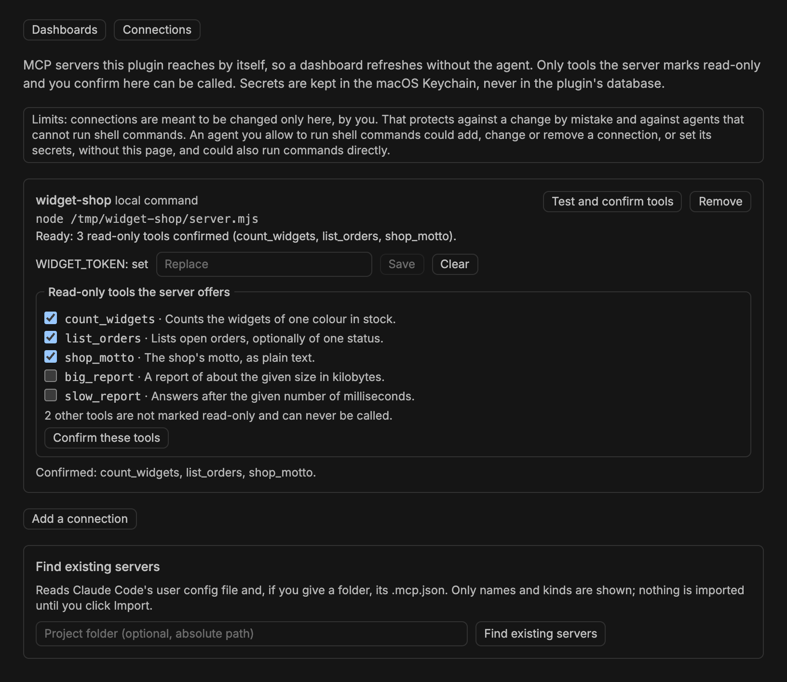

# Connections: the plugin's own MCP servers

A dashboard can refresh data from an outside system with no model call when the plugin itself can reach that system. For that, the plugin keeps its own MCP connections, which you add in the Connections section of the Dashboards page. bb gives plugins no access to the agent's own MCP connectors, so the plugin cannot borrow them, and a sign-in the agent holds is never copied. Only tools that the server marks read-only and that you confirm can ever be called. Tokens and other secrets go from the page straight to the operating system's secure store. This page covers adding and importing connections, confirming tools, what is and is not supported, and where secrets live.

<!-- SCREENSHOT connections-dark.png (the picture is ready at screenshots/connections-dark.png): the Connections section of the Dashboards page, dark mode: the Limits note and one invented local-command connection reading "Ready: 3 read-only tools confirmed", its secret shown as "set", the list of tools the server offers, and "Find existing servers". Rules for a replacement: about 1,580 px wide (at least 1,200), PNG under 2 MiB, stock bb theme, invented data only, no thread list or project name. To show it, add this line here:  and, if you want it, this caption on its own line: *The plugin's own MCP connections, on the Dashboards page.* -->

## Kinds of connection

| Kind | What you give | Secrets |
| --- | --- | --- |
| Local command (stdio) | A command, its arguments (one per line), plain variables (`NAME=value`, shown on the page) and the names of secret variables | Each secret variable's value, entered after adding |
| Web server (streamable HTTP) | An `https` address (plain `http` only on this machine) | An optional token, sent as `Authorization: Bearer <token>`, and the names of secret headers, whose values are entered after adding |

Rules the page and the server check:

- Name: letters, digits, `_`, `.` and `-`, starting with a letter or digit, at most 40 characters, unique.
- Local command: command up to 500 characters, at most 50 arguments; `PATH` cannot be set (it comes from bb); a variable is either plain or secret, not both; at most 20 secret variables.
- Web server: an address up to 2,000 characters with no user name or password in it; at most 20 secret headers; `Authorization` cannot be a secret header name, because the token is sent in it.
- Each secret value is at most 2,048 bytes.
- A web connection needs `https://`. Plain `http://` is accepted only for this machine (`localhost`, `127.0.0.0/8`, `[::1]`), because to another machine the token would travel unencrypted. A connection already stored with such an address is refused when used, before its token is read: remove it and add it again with `https://`.

## Adding a connection

1. Open the Dashboards page in bb and choose Connections.
2. Click "Add a connection", pick the kind and fill in the fields. For a web server you can give the token in the same form; it is cleared from the page as soon as you add.
3. Set any secret values in their fields. A field is write-only: after Save it empties and shows only "set" or "not set". "Clear" removes the value.
4. The page lists the server's tools right after adding (or when you click "List tools").

When a connection is used, the plugin starts a local command with bb's tool path (`PATH`) plus that connection's own plain and secret variables, and nothing else from bb's environment. The server's error output is dropped. A web server gets its token and secret headers on each request.

A connection opens on first use, is reused while in use, and closes after 5 minutes idle, when the plugin stops, or after any failure. Connecting has 15 seconds, listing tools 10 seconds and a tool call 20 seconds before it counts as failed.

## Confirming read-only tools

- The list shows each tool the server marks read-only (`readOnlyHint: true`, exactly), with its description, and how many other tools there are. A tool with no mark counts as a write tool. Those can never be called, and no setting allows them.
- The first time, every read-only tool is ticked for you to review. Later, tools you confirmed before stay ticked and a tool that is new since then is marked "(new)" and waits for you.
- "Confirm these tools" saves your choice after asking the server again: each name must still be offered as read-only at that moment.
- At every call the plugin lists the server's tools again and calls the tool only if it is confirmed and still marked read-only. If the server stops marking it read-only, the call is refused before it reaches the server and the dashboard shows why. Each refresh therefore makes two requests: a listing, then the call.
- The plugin keeps each confirmed tool's description (up to 500 characters) and its input schema (when up to 4,000 characters), so the agent can write an `mcp` source without contacting the server.
- Tool listings follow the server's pages up to 20 pages. Tools beyond that can be neither confirmed nor called.

A read-only mark is the server's own claim. The plugin cannot check what a tool really does, so a read-only token or account on the server side is the real guarantee.

## Importing a server you already set up

"Find existing servers" reads Claude Code's user config file (`.claude.json` in your home folder) and, when you give a folder as an absolute path, that folder's `.mcp.json`. It runs only when you click it and shows only names and kinds, with the reason a server cannot be imported. Nothing is imported until you click Import on one server; the file is then read again on the server side and turned into a connection.

- Every environment variable of a local command and every header of a web server is imported as a secret, and the values found go straight to the secure store. A value written as `${VAR}` is left for you to set.
- An `Authorization: Bearer ...` header becomes the connection's token.
- The page then lists the server's tools for you to confirm, as for a new connection.

Not importable, with the reason shown:

- servers that sign in through the browser (OAuth), or get their headers from a helper command;
- servers using the older SSE transport, or a type the plugin does not know;
- a command, argument or address that uses `${...}` variables;
- an argument that looks like it carries a secret (move it into an environment variable and import again);
- an address with a user name, password or a secret-looking query parameter;
- a plain `http://` address to another machine;
- an `Authorization` header that is not a bearer token;
- a name that cannot become a connection name, or one that is already taken.

Only the top-level server list of Claude Code's user config file is read, not the per-project entries inside it.

## Using a connection in a dashboard

The agent sees each connection's name, its kind (local command or web server) and its confirmed tools with their descriptions and input schemas, through `dashboard_sources`. It never sees a command, an address, a variable or a secret. It can run a confirmed tool once to see the shape of its result, then declare an `mcp` source:

```text
{name: "stock", kind: "mcp", connection: "widget-shop", tool: "count_widgets", args: {colour: "teal"}, overridable: ["colour"]}
```

The agent cannot add, change or remove a connection, or confirm a tool. Details of the `mcp` source kind are in [data-sources.md](data-sources.md#mcp).

## Removing a connection

"Remove" closes the connection, deletes its secrets from the secure store, then deletes its record. If a secret cannot be deleted, the connection is kept so that its secrets can be removed later. A connection cannot be edited: remove it and add it again.

## Where tokens live

- In the operating system's secure store on the machine bb's server runs on, under the service name `bb-dashboards`: the macOS Keychain, Windows Credential Manager or the Linux Secret Service keyring. Only macOS has been tested on a real system.
- The plugin talks to each store through the system's own tool (`security` on macOS, Windows PowerShell's Credential Manager vault, `secret-tool` on Linux). A secret is passed on standard input, never on a command line where other programs could see it.
- The plugin's database records only which secrets are set, never a value. A value never appears in a dashboard, a log, the page or anything the agent sees, and known secret values are replaced by `[secret]` in error messages.
- If the machine has no working secure store, connections that need a secret cannot be added, and the page says why. There is no fallback to a file.

## What this page cannot stop

The page shows this note:

> Limits: connections are meant to be changed only here, by you. That protects against a change by mistake and against agents that cannot run shell commands. An agent you allow to run shell commands could add, change or remove a connection, or set its secrets, without this page, and could also run commands directly.

The reason: bb reports its own app, its command line and agents as the same kind of caller, so the plugin cannot tell your click from a command. Other plugins are refused on every function, listing connections and their tools included. See [security-and-privacy.md](security-and-privacy.md#who-can-call-the-plugins-functions).

## Related pages

- [data-sources.md](data-sources.md): the `mcp` source kind and refreshing.
- [scripts.md](scripts.md): when no connection reaches the data.
- [limits.md](limits.md#connections): connection limits in one list.
