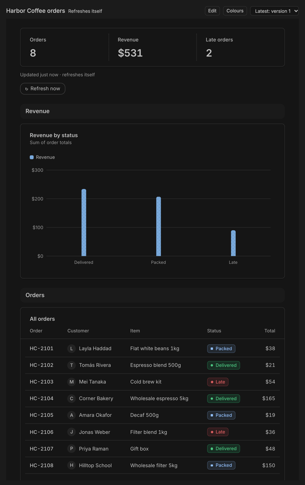

# Live data: sources

A dashboard can load its data instead of having it written into the program. It declares named, read-only sources when it is saved, and its program reads each one with a `Query` statement. Four kinds read things bb already knows about the thread the dashboard was made in: a JSON or CSV file, the branch's commits, its changed files and its pull request. Three more kinds cover everything else: data the agent fetches and hands over, a read-only tool of an MCP connection you added, and a script you approved. All but the agent kind refresh by themselves, with no model call. This page covers declaring and reading sources, each kind with its limits, refreshing, and what happens when a source fails.

<!-- SCREENSHOT live-data-dark.png (the picture is ready at screenshots/live-data-dark.png): a dashboard over a JSON file, dark mode: the header label "Refreshes itself", KPI tiles, a Freshness line reading "Updated just now · refreshes itself", a Refresh button, a bar chart and a table. Rules for a replacement: about 1,580 px wide (at least 1,200), PNG under 2 MiB, stock bb theme, invented data only, no thread list or project name. To show it, add this line here:  and, if you want it, this caption on its own line: *A dashboard that reads a JSON file and refreshes itself.* -->

## Declaring sources

The agent passes the list as `dashboard_save`'s `sources`. The list is saved with each version: left out of a later save, the current list stays; `[]` removes every source.

- Each source is `{name, kind, ...}`. A name is a letter, then letters, digits or `_`, at most 40 characters, and each name is used once.
- At most 12 sources per dashboard.
- Only a file source names anything on disk, and its path is fixed in the declaration. The browser never sends a path, a command, a tool name or a thread: it names a declared source of a version, and the server looks the declaration up.

## Reading a source

Each source is read with its own top-level statement:

```text
name = Query("source", {args}, {defaults}, seconds)
```

- `"source"` is a declared source name, in quotes. The save check refuses a `Query` that names an undeclared source or that is not a whole statement of its own.
- `{args}` are the arguments for that kind (see below). A `$variable` in them makes the query run again when a filter, search box or other control changes it.
- `{defaults}` is what shows until the first answer, in the result's shape with empty lists: `{rows: []}`.
- `seconds` is optional. Left out, the query runs when the dashboard opens and when its arguments change. Given, it must be a number written into the program, at least 10 (30 for a script source), and the query also runs on that timer while the dashboard is shown.

Fields are read with a pluck and the built-ins, for example `orders.rows.total` and `@Sum(orders.rows.total)`. When a source holds the data, the agent is told to keep the data out of the program: only the `Query` and what is computed from it.

The agent can see a real result before it writes the program: `dashboard_sources` with a `kind` (and a `path` for a file) runs that source once for the current thread and shows the result, cut at 6,000 characters. It never runs a script.

## The kinds

| Kind | What it reads | Args | Refreshes | Limits |
| --- | --- | --- | --- | --- |
| `file` | A JSON or CSV file in the thread's working folder or its thread storage folder | none | by itself | 1 MB; `.json` or `.csv`; relative path, no `..` |
| `git_commits` | The branch's commits since it left its base branch, newest first | `{limit}`: 1 to 100, default 20 | by itself | none on the base branch itself |
| `git_changes` | Changed files with lines added and deleted | `{scope}`: `"branch"` (default) or `"uncommitted"` | by itself | 200 files listed; totals count all |
| `pull_request` | The branch's pull request with checks, review and mergeability | none | by itself | needs bb's GitHub pull request status plugin |
| `agent` | Data the agent fetched with its own tools and stored | none | asks the agent (one model turn) | 256 KB per source; latest result only |
| `mcp` | A confirmed read-only tool of one of the plugin's MCP connections | only the names the declaration allows | by itself | result up to 1 MB; see [connections.md](connections.md) |
| `script` | A script you read and approved, run on your machine | any JSON object, on the script's standard input | by itself, once approved | 20 s, 1 MB output; see [scripts.md](scripts.md) |

The `file`, `git_commits`, `git_changes`, `pull_request` and `script` kinds read through the thread the dashboard was made in, which is recorded when the dashboard is first saved. A later change from another thread does not move it. When that thread is deleted, or its environment folder is gone, those sources fail with a message.

### file

```text
{name: "results", kind: "file", path: "reports/results.json"}
{name: "orders", kind: "file", path: "exports/orders.csv", root: "storage"}
```

- `path` is relative to the thread's working folder (`root: "environment"`, the default) or to its thread storage folder (`root: "storage"`). At most 300 characters, no `..` parts, ending in `.json` or `.csv`.
- bb reads the file and resolves links on the way; a file that ends up outside the folder is refused.
- A `.json` file arrives as written. A `.csv` file arrives as `{rows: [...]}`, one object per line keyed by the header line. Quoted fields may hold commas, line breaks and `""` for a quote. A field becomes a number only when it is written exactly the way JavaScript writes that number (`42`, `-3.5`); `007`, `1e3`, `12.50` and empty fields stay text.
- There is no file watching: a changed file shows on the next timer tick, Refresh or open.

### git_commits

```text
{name: "commits", kind: "git_commits"}
```

Read through bb's built-in Git plugin. The result is `{branch, base, ahead, behind, commits: [{sha, shortSha, subject, author, authoredAt}], total}`. "Commits" means the branch's commits since it left its base branch, because bb offers no general commit log; on the base branch itself the list is empty.

### git_changes

```text
{name: "changes", kind: "git_changes"}
```

The result is `{scope, branch, base, files: [{path, previousPath, kind, additions, deletions, binary}], totals: {files, additions, deletions}, truncated}`. With `scope: "branch"` (the default) it lists everything since the base branch, uncommitted work included; on the base branch itself, or with no base branch, it lists only the uncommitted work. `scope: "uncommitted"` always lists only the uncommitted work. At most 200 files are listed; `totals` counts every file and `truncated` says when some were left out.

### pull_request

```text
{name: "pr", kind: "pull_request"}
```

Read through bb's built-in GitHub pull request status plugin. The result is `{exists, number, title, url, state, base, head, updatedAt, checks: {state, passed, failed, pending, total}, review: {state, requests}, mergeability, attention}`, or `{exists: false, message}` when the branch has no pull request.

### agent

```text
{name: "incidents", kind: "agent", description: "Open incidents from the help desk tool, last 7 days"}
```

For data only the agent can reach. The agent fetches it with its own tools and stores it with `dashboard_save`, passing the dashboard's `id` and `data: {incidents: <JSON>}`. A save with only `id` and `data` stores the result and adds no version. Each result replaces the source's last one, up to 256 KB per source. `description` (optional, at most 300 characters) says what the agent fetches and with which tool, so a later agent can do it again.

When an agent source is refreshed, the panel sends one message to the dashboard's thread asking the agent to get the data again and save only the id and data, without changing the program. That costs one model turn. See [Refresh](#refresh-freshness-and-the-refresh-button).

When the plugin holds connections with confirmed tools and a dashboard has agent sources, the save's answer tells the agent so, in case one of those tools serves the same data and an `mcp` source could refresh without it. Nothing is switched by itself.

### mcp

```text
{name: "stock", kind: "mcp", connection: "widget-shop", tool: "count_widgets", args: {colour: "teal"}, overridable: ["colour"]}
```

`args` are fixed (at most 2,000 characters of JSON); a `Query` may set only the argument names listed in `overridable` (at most 20). The result is the tool's structured content, else its text parsed as JSON, else the text, up to 1 MB. Saving refuses a connection name that does not exist or a tool that is not confirmed. Details in [connections.md](connections.md).

### script

```text
{name: "jobs", kind: "script", runner: "python3", why: "Open jobs per state from the shop's job queue tool", code: "<the whole script>", secrets: ["QUEUE_READ_TOKEN"]}
```

Runs only after you read and approved it in the panel. Details in [scripts.md](scripts.md).

## Refresh, Freshness and the refresh button

- The panel header names how the dashboard refreshes: "Refreshes itself", "Refresh asks the agent" (when any source is an agent source), "Needs your approval" (a script waits for approval) or "Scripts cannot run here". A dashboard with no sources shows no label.
- `Freshness("results")` shows when that source last answered, such as "Updated 2 minutes ago", and how it refreshes. It moves on by itself every 15 seconds without fetching anything.
- `RefreshButton()` re-runs every source now; `RefreshButton("Refresh incidents", "incidents")` re-runs one. File, git, pull request, MCP and approved script sources re-run at once. For agent sources it sends the message described above instead.
- While the dashboard's side-panel tab is hidden, nothing is fetched: queries answer from their last result, and a query with no result yet waits. When the tab shows again, the queries run once. On the Dashboards page there is no tab to hide.
- When the agent stores new data, or saves a new version, open panels show it without a reload: the server sends a realtime notice with only the dashboard's id and the version or source names, and the panel fetches the rest. A panel that was disconnected loads the dashboard again when the connection returns, because missed notices are not replayed.

## The refresh floor and the rate limit

| Rule | Value | Where it is set |
| --- | --- | --- |
| Shortest refresh interval | 10 s | `MIN_REFRESH_SECONDS` in `server/sources.ts` |
| Shortest refresh interval for a script source | 30 s | `SCRIPT_MIN_REFRESH_SECONDS` in `shared.ts` |
| Real runs per dashboard and source | 20 a minute | `RATE_LIMIT` in `server/run.ts` |
| Script runs at once, per source | 1 | `server/run.ts` |

- The floor is checked twice: the save check refuses a shorter interval, and the server answers a repeat request within the floor from a short cache. The cache key holds the dashboard, the source's declaration and the arguments, so two open panels asking at once share one run.
- Agent sources are never cached, so newly stored data shows at once; their reads still count toward the rate limit.
- The cache and the rate limit live in the plugin's memory and reset when the plugin reloads.

## When a source fails

- Every failure is a value with a sentence, never made-up data. The query keeps its defaults, the chart or table shows the library's notice, and the panel shows "Source results did not load:" followed by the reason.
- A failure is not cached, so the next request runs again at once, within the rate limit. Past the rate limit the panel says when to try again.
- A script source that waits for approval, cannot run on this machine or misses a secret shows its own line with what to do, and is never asked for; the rest of the dashboard works.
- A failing script's last error output (at most 300 characters, with known secret values replaced by `[secret]`) is shown to you. The agent never sees it.

## Example

An invented test report: the program reads a JSON results file written by a test run and the branch's changed files. Saved with `sources: [{name: "results", kind: "file", path: "reports/results.json"}, {name: "changes", kind: "git_changes"}]`, where the file holds `{"rows": [{"test": "applies coupon once", "suite": "checkout", "status": "failed", "ms": 412}, ...]}`. It passes the save check as written.

```text
root = Dashboard([lead, detail])
results = Query("results", {}, {rows: []}, 30)
changes = Query("changes", {scope: "branch"}, {files: [], totals: {files: 0, additions: 0, deletions: 0}})
lead = Section("", [Kpis([Kpi("Tests", @Count(results.rows), "number"), Kpi("Failed", @Count(failed), "number", null, "down"), Kpi("Slowest test", @Max(results.rows.ms), "ms"), Kpi("Files changed", changes.totals.files, "number")]), Freshness("results")])
detail = Section("Detail", [Row([Card("Failures", [Table([Column("Test", failed.test, "primary"), Column("Suite", failed.suite, "chip"), Column("Time", failed.ms, "number", "ms")])], "half"), Card("Changed files", [Table([Column("File", changes.files.path, "primary"), Column("Added", changes.files.additions, "number"), Column("Deleted", changes.files.deletions, "number")])], "half")]), RefreshButton()])
failed = @Filter(results.rows, "status", "==", "failed")
```

## Related pages

- [connections.md](connections.md): the plugin's own MCP connections.
- [scripts.md](scripts.md): script sources and the approval dialog.
- [security-and-privacy.md](security-and-privacy.md): what keeps every path read-only.
- [limits.md](limits.md#data-sources): data source limits in one list.
