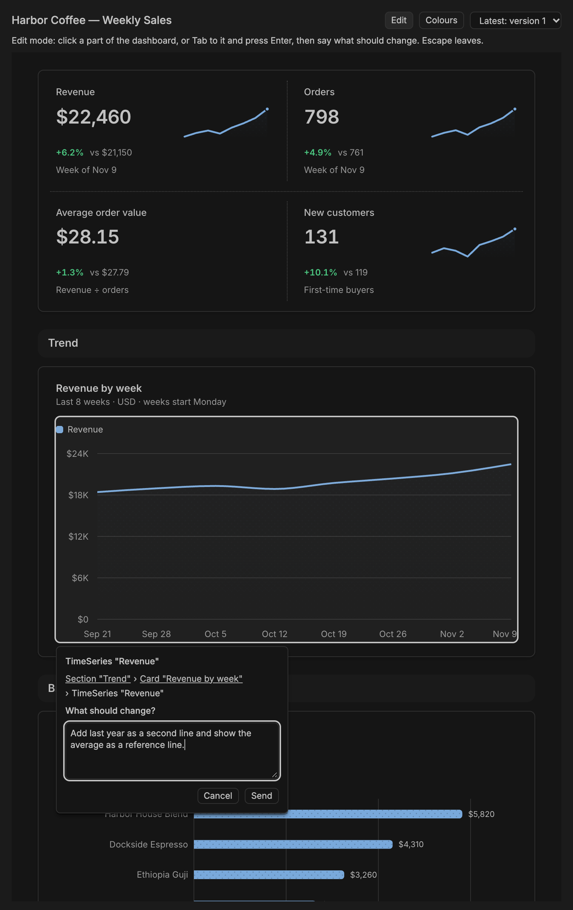
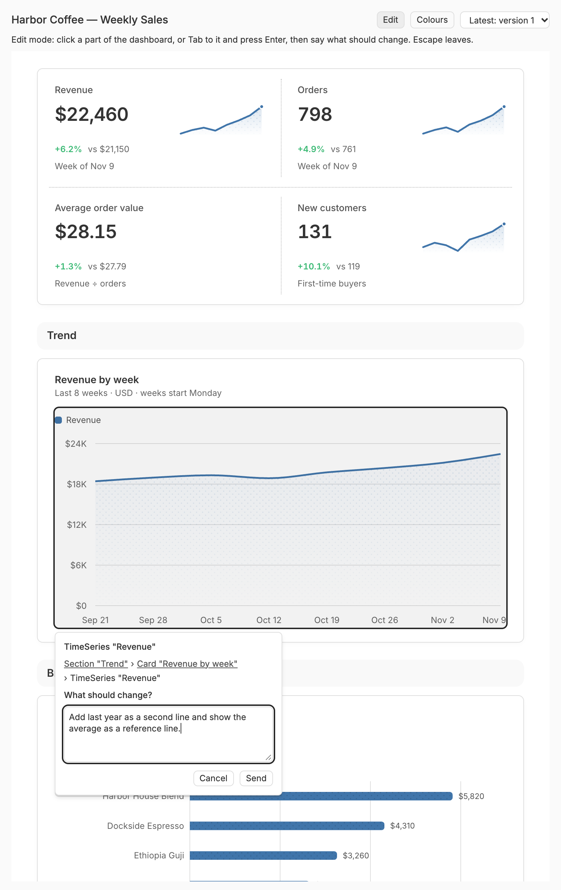

# Changing a dashboard: prompts, versions and Edit mode

A dashboard is changed by asking for the change, the same way it was made: "add a chart by region", "make it dark green", "mark the third task Done". The agent sends only the statements that change, the plugin checks the whole result and saves it as a new version, and any open panel redraws. The newest 100 versions stay available to view and to restore. Edit mode lets you point at the part you mean instead of describing it: you click a chart or card, type what should change, and the plugin sends the agent a message that names the part and quotes the piece of the program it comes from. This page covers all three.

<!-- SCREENSHOT edit-mode-dark.png (the picture is ready at screenshots/edit-mode-dark.png): Edit mode on, dark mode: the revenue chart outlined and selected, and the popover with breadcrumbs (Section › Card › TimeSeries), a typed request, and Cancel and Send. Rules for a replacement: about 1,580 px wide (at least 1,200), PNG under 2 MiB, stock bb theme, invented data only, no thread list or project name. To show it, add this line here:  and, if you want it, this caption on its own line: *Edit mode: the selected chart, where it sits, and the request to send.* -->

<!-- SCREENSHOT edit-mode-light.png (the picture is ready at screenshots/edit-mode-light.png): the same scene as edit-mode-dark.png in bb's light mode. Rules for a replacement: about 1,580 px wide (at least 1,200), PNG under 2 MiB, stock bb theme, invented data only, no thread list or project name. To show it, add this line here:  and, if you want it, this caption on its own line: *The same in light mode.* -->

## Changing by prompt

Ask in the thread the dashboard was made in. The plugin's tools and skill are offered in every thread, helper threads included, so a dashboard stays changeable from the thread that made it.

What the agent does:

1. Reads the current program, theme and sources with `dashboard_get` and the dashboard's id.
2. Saves with `dashboard_save`: the id and a `patch` holding only the new or changed statements. A statement written as `name = null` is removed, and statements the root no longer reaches are dropped. It can instead send a whole `program`, or change only the `title`, `theme` or `sources`.
3. The plugin merges the patch into the current program (with OpenUI's statement merge), then runs the full save check on the result. If anything fails, nothing is stored and the agent gets the list of problems to fix. See [agents.md](agents.md#the-save-check).
4. On success the change is saved as the next version, and every open panel of that dashboard loads it at once through a realtime notice.

The agent finds a dashboard by its id. The id is in the card block in the reply, and in every message the panel sends (Edit mode, AskAgent, agent refresh). There is no agent tool that lists dashboards by title.

A save that only stores data for agent sources (`id` and `data`) adds no version.

## Versions

- Every successful save that changes the program, title, theme or sources adds a version, numbered from 1. The newest 100 are kept: a save past that deletes the oldest, for good. Numbers go on from the highest and are never reused.
- The header's version list shows "Latest: version N" and every earlier kept version with the time it was saved.
- A view on the latest version moves to a new version as soon as it is saved. It keeps your filter choices and live state, so the dashboard does not start over.
- An older version opens read-only, with a line "Version 2 of 4, read-only", a "Back to latest" button and a "Restore this version" button. It notes when a newer version was saved while you were looking. If a save deletes the version you are looking at, the view moves to the latest and says so. On an old version:
  - its own declared sources still load, so it shows its data as that version read it;
  - Edit mode is off, and AskAgent buttons and agent refreshes are not sent;
  - your filter choices are not remembered;
  - a script that waits for approval cannot be approved there (approval is only for the latest version).
- "Restore this version" saves that version's program, theme and sources as a new latest version, and the view moves to it. Nothing is overwritten: the versions in between stay in the list. Other open views of the dashboard learn of it as after any save.
- A restore goes through the same save check as any save. If the old program no longer passes, it is refused with the reasons, and nothing is saved.
- A restore keeps the dashboard's current title, and its agent sources show the latest data the agent stored: neither the title nor agent data is versioned.
- Restoring approves nothing. A script in the restored version runs only if exactly that script is approved now. See [scripts.md](scripts.md#what-an-approval-covers).
- Like any save, a restore removes the script secrets and approvals its version no longer uses, so going back to a later version can mean entering them again.
- The agent's tools read only the latest version; restoring is done in the panel.

## Remembered choices

The panel remembers the `$variable` values you moved away from the program's defaults, such as a picked filter, the shown tab or the selected record, so the dashboard opens the way you left it.

- They are kept in the browser's local storage on that device, one entry per dashboard, at most 20,000 characters.
- A remembered value is used only while it still has the type of the program's declared default (any type when the default is `null`). A variable you never touched follows the program's new default after a change.
- The program has no say in what is remembered, and nothing is sent to the server.
- Deleting the dashboard from the Dashboards page removes the entry in that browser.

## Edit mode

Every dashboard's header has an Edit button.

While Edit mode is on:

- The dashboard stops responding to the pointer and keyboard (it is made inert), so a click selects a part instead of triggering it.
- The pointer outlines the part under it. A click selects that part. With the keyboard, Tab moves through the parts in page order and Enter selects one.
- A popover opens beside the selected part, staying inside the visible area of the panel. It shows the part's name (its kind and its title or label, such as `Card "Jobs by status"`), breadcrumbs of the parts it sits in, each clickable to select that part instead, a "What should change?" box (up to 2,000 characters), and Cancel and Send.
- Escape closes the popover; Escape again leaves Edit mode.

What is selectable: sections, cards, the filter bar and each filter, KPI strips and tiles, charts, tables and the plugin's own components, and a Frame as a whole. Not selectable: the root, layout rows, a single Tab (its Tabs and the parts inside it are), single records inside a RecordList, a single series or column inside a chart or table, popovers, and anything inside a Frame.

### What is sent

Send delivers one message, built by the panel:

- which dashboard (title and id) and which version;
- the selected part, the parts it sits in, and where it is in the program: the named statement it is, or the statement it is written inside (with its position when several parts of the same kind are written there);
- the source text of that statement, quoted (up to 1,500 characters);
- your request, quoted;
- an instruction to change only that with a `dashboard_save` patch of that statement and to leave the rest unchanged.

An invented example (the quoted statement is shortened here):

````text
Change request for dashboard "Workshop repair queue" (id 3f9a1c07b2de), version 4.
Target: Card "Jobs by status" in Section "Repair jobs", written inline in statement queue (Card 2 of 2 there).
Source of queue:
```openui
queue = Section("Repair jobs", [Row([Card("Jobs", [...], "two-thirds"), Card("Jobs by status", [Donut(...)], "third")]), details])
```
Requested change:
```text
Show this as horizontal bars, sorted from most to fewest jobs.
```
Change only this with a dashboard_save patch of queue; leave the rest unchanged.
````

### Where it is sent

- From the side panel: to the thread whose side panel shows the dashboard.
- From the Dashboards page: to the thread the dashboard was made in. If that thread no longer exists, the message is not sent and the popover says so.
- If the agent in that thread is busy, the message waits in the thread's queue.

Each Send costs one agent turn; Edit mode costs nothing otherwise. Nothing was added to the agent's skill or tools for it: the message carries everything the agent needs. In the real app, the agent changed only the selected part, and where a request needed something outside that part, it said so and asked before going further.

### Limits

- Two identical parts side by side map to the first of them.
- Latest version only, one part per message.

## Related pages

- [getting-started.md](getting-started.md): the first change, step by step.
- [agents.md](agents.md): what the agent sees and the save check.
- [themes-and-colours.md](themes-and-colours.md): theme changes compared with the viewer's Colours control.
- [limits.md](limits.md#edit-mode): every Edit mode limit.
