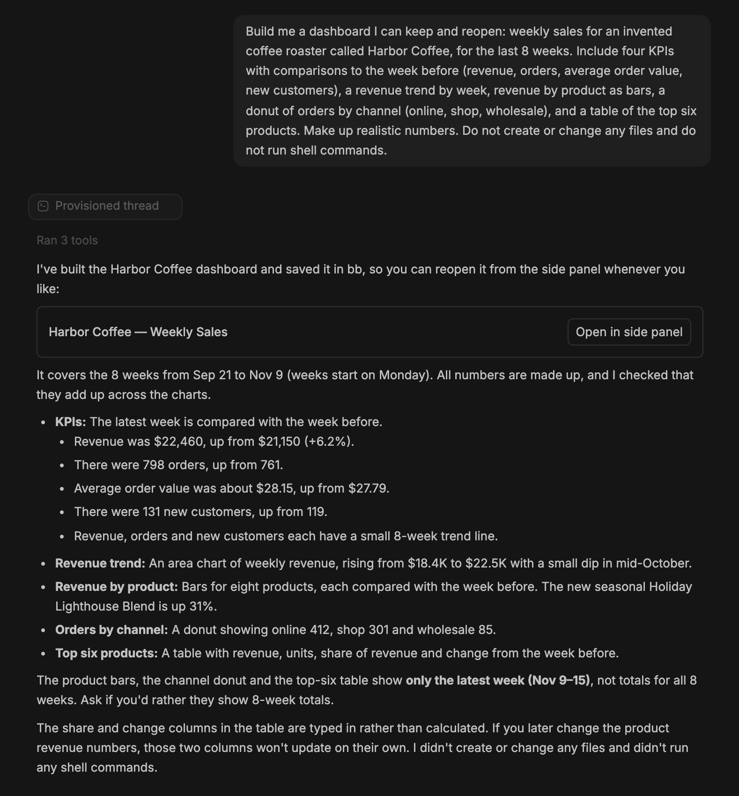
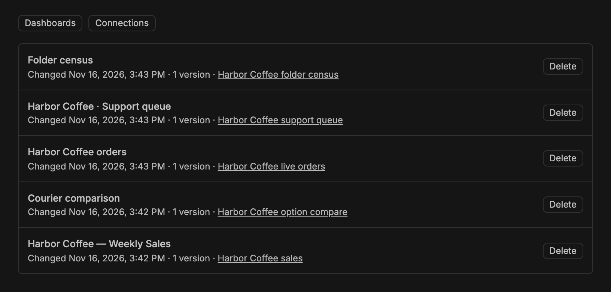

# Getting started

This page takes you from installing bb Dashboards to a dashboard you keep: you ask an agent for a dashboard in a thread, the agent saves it, the reply shows a card, and the card opens the dashboard in bb's side panel. You then change it by asking again, use it with no model calls, and reopen it later from the card or from the Dashboards page. Nothing needs to be set up before the first prompt: the agent builds the first version with the tools it already has.

## Requirements

- bb 0.49 or later (the plugin's `engines` field; plugin SDK 0.6.132 or later).
- An agent provider in bb. Only the Claude Code provider has been tried.
- For a path install: git, npm and bb's command line.

Optional, only for the features that use them:

- Git and pull request sources use bb's built-in Git and GitHub pull request status plugins.
- Connections with a token need the operating system's secure store (tested on macOS only).
- Script sources need macOS (Linux is supported by the code but untested; Windows is not supported), the thread's environment on the machine bb's server runs on, and the runner (`sh`, `bash`, `python3` or `node`) on bb's tool path.

## Install

From a local checkout of the repository:

```sh
cd bb-plugin-dashboards
npm ci                # install scripts stay off (see development.md)
bb plugin install .   # register this folder with bb; bb builds it
```

<!-- INSTALL: once the repository is public, add its git install line here, for example
     bb plugin install git:https://github.com/OWNER/bb-plugin-dashboards.git@main
     and, once the plugin is listed, the marketplace install line. Installing from git has not been tested yet. -->

After installing, bb shows a Dashboards page in its navigation, and agents in every thread get the `dashboards` skill and the three `dashboard_*` tools.

## Your first dashboard

1. Open a thread and ask for something you want to keep. For example:

   > Build me a dashboard of this week's orders by channel for a small online bakery, with made-up numbers.

2. The agent loads the skill, gathers or invents the data as asked, and saves the dashboard with `dashboard_save`. If the save check finds a problem, the agent gets the list, fixes it and saves again; nothing is stored until the program passes.
3. The reply shows a card with the dashboard's title and an "Open in side panel" button.

<!-- SCREENSHOT card-in-reply-dark.png (the picture is ready at screenshots/card-in-reply-dark.png): the chat column only, dark mode: the user's prompt and the agent's reply ending with the dashboard card and its "Open in side panel" button. Rules for a replacement: about 1,580 px wide (at least 1,200), PNG under 2 MiB, stock bb theme, invented data only, no thread list or project name. To show it, add this line here:  and, if you want it, this caption on its own line: *The card in the reply opens the dashboard in the side panel.* -->

4. Click "Open in side panel". The dashboard opens in its own tab in the thread's side panel. If bb cannot open the side panel there, the card says so and links to the Dashboards page instead.

What works now with no model call: filters, tabs, search boxes, toggles and sliders; picking an item in a list to open its details; switching versions; the Colours button.

A chart or table that only answers your current question stays in the reply. The skill makes a dashboard when you want to keep, reopen, change later or refresh what you asked for.

## Live data

A dashboard can load its data instead of having numbers written in. Ask for it:

> Make a dashboard of the test results in reports/results.json and the files changed on this branch. Keep it updating.

The agent declares sources (here a file and the branch's changed files) and reads them with `Query` statements. The panel header then says "Refreshes itself", and the dashboard reloads its data on open, when a filter it passes to a source changes, on its timer (every 10 seconds at the shortest) and when you press Refresh, all without a model call. For data only the agent can reach, the header says "Refresh asks the agent", and Refresh sends one message to the thread. See [data-sources.md](data-sources.md).

## The edit loop

Three ways to change a dashboard:

- Ask in the thread: "add a chart by region", "make it dark green", "change Feb to 140". The agent sends only the statements that change; the plugin checks the whole result and saves it as the next version. The open panel redraws, keeping your filter choices.
- Edit mode: click Edit in the dashboard's header, click the part you mean, type what should change and press Send. The message names the part and quotes its piece of the program, so the agent changes only that.
- Colours: pick an accent, chart colours or a light or dark look for yourself. This is kept in your browser, costs no model call and makes no version.

The newest 100 versions stay available in the header's version list, read-only, and an old one can be restored as the new latest version. See [editing.md](editing.md) and [themes-and-colours.md](themes-and-colours.md).

## Reopening a dashboard

- Click its card again in the thread where it was made.
- Or open the Dashboards page from bb's navigation. It lists every dashboard, last changed first, with its number of versions and a link to the thread it was made in. Click a title to open the dashboard on the page; "All dashboards" goes back to the list. Delete asks first, then removes the dashboard with all its versions.

<!-- SCREENSHOT dashboards-page-dark.png (the picture is ready at screenshots/dashboards-page-dark.png): the Dashboards page, dark mode: the Dashboards / Connections switch and five invented dashboards, each with its last change, number of versions, a link to the thread it was made in, and Delete. Rules for a replacement: about 1,580 px wide (at least 1,200), PNG under 2 MiB, stock bb theme, invented data only, no thread list or project name. To show it, add this line here:  and, if you want it, this caption on its own line: *Every dashboard in one list.* -->

Your remembered filter, tab and selection choices come back when you reopen a dashboard in the same browser.

## Next

- [components.md](components.md): everything a dashboard can contain.
- [connections.md](connections.md) and [scripts.md](scripts.md): refreshing data from outside systems without the agent.
- [limits.md](limits.md): what is not supported and what is untested.
