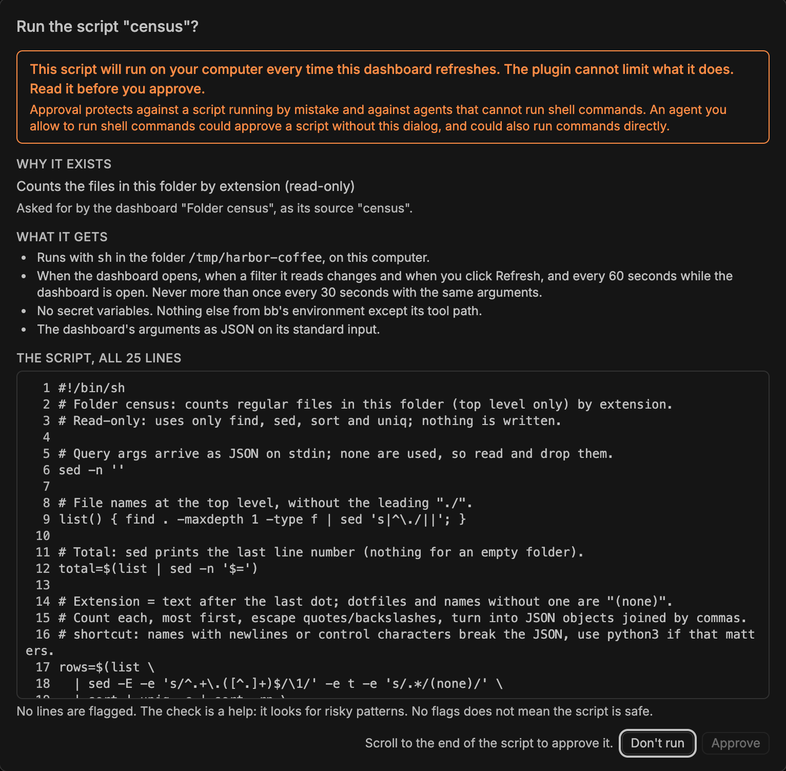

# Script sources and approval

When no built-in source and no connection reaches the data, an agent can declare a script source: a short script that runs on your computer, reads its arguments as JSON and prints one JSON value. A script never runs until you have read it and approved it in the dashboard's panel, and an approval covers exactly the text you read. The plugin cannot limit what an approved script does, so the approval dialog is built to make you read it: it warns, shows the whole script, flags risky lines and keeps Approve off until you have scrolled to the end. This page covers declaring scripts, the runner and its limits, the dialog, secrets and withdrawing approval, and what approval does not protect against.

<!-- SCREENSHOT script-approval-dark.png (the picture is ready at screenshots/script-approval-dark.png): the approval dialog for a 25-line read-only script, dark mode: the warning banner with the limit line, "Why it exists", "What it gets", the whole script, "No lines are flagged." with the note that no flags does not mean safe, "Don't run" focused and Approve still disabled. No flagged line is shown. Rules for a replacement: about 1,580 px wide (at least 1,200), PNG under 2 MiB, stock bb theme, invented data only, no thread list or project name. To show it, add this line here:  and, if you want it, this caption on its own line: *The approval dialog for a short read-only script; Approve is still off.* -->

## Declaring a script source

```text
{name: "jobs", kind: "script", runner: "python3", why: "Open jobs per state from the shop's job queue tool", code: "<the whole script>", secrets: ["QUEUE_READ_TOKEN"]}
```

The save check refuses a script source unless:

- `runner` is one of `sh`, `bash`, `python3` or `node`;
- `code` is at most 20,000 characters;
- `why` is one line of at most 200 characters (what the script fetches, and from where);
- `secrets` lists at most 10 environment variable names, each once, made of letters, digits and `_` and not starting with a digit. Names that change how code is loaded are refused: `PATH`, `ENV`, `IFS`, `PS4`, `SHELLOPTS`, `BASHOPTS`, `BASH_*`, `NODE_*`, `PYTHON*`, `LD_*` and `DYLD_*`;
- neither `code` nor `why` contains control, invisible or direction-changing characters, which could make the text you read differ from what runs. Tabs and line breaks are allowed;
- every `Query` that reads it with a timer uses at least 30 seconds.

After such a save the agent is told the script waits for your approval, and that it cannot approve it by any route: no tool, no parameter, not bb's command line, not the plugin's functions or its database. `dashboard_sources` and `dashboard_save` never run a script.

## How a script runs

- On the machine bb's server runs on, in the working folder of the thread the dashboard was made in. Not on Windows, and not for a thread whose environment is on another machine; such a dashboard says "Scripts cannot run here" and never offers approval.
- The code is passed to the runner as one argument (`-c`, or `-e` for `node`). The `Query`'s arguments arrive as JSON on standard input, never in the command text.
- Its environment holds only bb's tool path (`PATH`) and the secret variables it names, with the values you entered. Nothing else from bb's environment.
- It must print one JSON value on standard output and nothing else, and exit with code 0.
- Limits per run: 20 seconds (`SCRIPT_TIMEOUT_MS` in `server/sources.ts`) and 1 MB of output (`MAX_SCRIPT_OUTPUT`). The script runs in its own process group: when it hits either limit, when it exits, or when the plugin stops or reloads, the whole group is stopped, including anything it started in the background.
- One run at a time per source; a second request while one runs is refused, not queued.
- Refresh floor 30 seconds (`SCRIPT_MIN_REFRESH_SECONDS` in `shared.ts`), checked at save and again on the server, which answers a repeat within 30 seconds from its cache.
- When a run fails, you see the reason and the last 300 characters of the script's error output, with known secret values replaced by `[secret]`. The agent never sees that output.

## The approval dialog

A script source that is not approved shows a line in the panel: "waiting for your approval", with a "Review script" button. The rest of the dashboard works without it, and the panel header reads "Needs your approval". Approval is offered only on the latest version.

The dialog shows, in order:

| Part | What it shows |
| --- | --- |
| Warning | "This script will run on your computer every time this dashboard refreshes. The plugin cannot limit what it does. Read it before you approve." and the limit line quoted below. Always shown. |
| What changed | For a script you approved before and that has since changed: the runner change, secret variables added or removed, and the changed lines, first. |
| Why it exists | The agent's one line, and which dashboard and source asked for it. |
| What it gets | The runner and the folder it runs in; when it runs (on open, when a filter it reads changes, on Refresh, and on its timer while open, never more than once every 30 seconds with the same arguments); the names of its secret variables, never their values; and that its arguments arrive as JSON on standard input. |
| The script | The whole text with line numbers, never shortened or folded. Flagged lines are highlighted, each with its reason. A note says the check is a help and that no flags does not mean the script is safe. |
| Buttons | "Don't run" has the focus. "Approve" stays off until you have scrolled to the end of the script and, when lines are flagged, ticked "I have read the flagged lines". |

Escape is the same as "Don't run". The focus stays inside the dialog while it is open. One dialog approves one script: there is no "approve all" and no "always allow".

### Flagged lines

Each line is checked against patterns for things a read-only script should not need, each with a short reason: deleting files; moving, copying or overwriting files; sending output into a file; writing a file; changing permissions or owners; asking for elevated rights; installing packages; running code it downloads or builds; sending data out (an upload, or a POST, PUT, PATCH or DELETE request); sending mail; copying files to or from another machine; opening a remote shell or a raw network connection; changing or pushing to a repository; changing data in a database; stopping processes or the machine; reading credentials; reading every environment variable; and starting something that keeps running in the background. The patterns are in `ui/flags.ts`. They are a reading aid and easy to get around.

## What an approval covers

- An approval is recorded for one dashboard and one source name, against a hash of the runner, the code and the secret variable names. A secret's value is not part of it.
- Any change to the runner, the code or the secret names asks again: the source shows "waiting for your approval: it changed since you approved it", and the dialog shows what changed first.
- A later version with exactly the same script keeps the approval. An old version whose script no longer matches does not run.
- When a source stops being a script source, its approval is withdrawn, so no old version runs it unseen.
- Restoring an old version in the panel approves nothing. Its script runs only if exactly that script is approved now; otherwise it waits for your approval.
- Approving fails if the script changed after you opened the dialog; open it again and read the new text.

## Secrets for scripts

- When a script of the latest version names secret variables, the panel shows a write-only field for each one that is not set yet; an approved script with a missing value says it needs that value before it runs. After Save the field empties and shows only "set".
- Values go to the operating system's secure store (service `bb-dashboards`), one entry per dashboard and variable name, and are passed to the script as environment variables on each run.
- Changing a value keeps the approval, because the value is not part of what you approved.
- A value is removed when no script of the dashboard's latest version names it any more, and when the dashboard is deleted.

## The "Runs a script" badge and withdrawing

A dashboard with an approved script shows a "Runs a script" badge in its header. From it you can read each approved script again (with the date you approved it), set or clear its secrets, and withdraw its approval. Withdrawing stops the script at once: a run in progress is stopped with everything it started, it ends with an error saying the approval was withdrawn, and nothing it printed is shown or kept. The script is not started again and its cached answer is no longer served; the rest of the dashboard keeps working. Deleting a dashboard stops its running scripts the same way.

## What approval does not protect against

The dialog itself says:

> Approval protects against a script running by mistake and against agents that cannot run shell commands. An agent you allow to run shell commands could approve a script without this dialog, and could also run commands directly.

In plain words:

- bb cannot tell a click in the plugin's page from a bb command run in a shell. An agent you allow to run shell commands could therefore call the plugin's approve function through bb's command line, without the dialog. Such an agent can also run any command on your machine directly, so the dialog adds no protection there.
- Approval is not a sandbox. An approved script can do anything your user account can do, network access included, and on macOS it can probably read the plugin's other Keychain entries with the system's own tool. Its environment is small, but it is not confined.
- A script that deliberately moves itself to another process group (with `setsid`, for example) can outlive the time limit.
- Use read-only commands and read-only credentials. Those are the real guarantee.

Other limits: approving in one open view of a dashboard does not update another open view until it reloads, and a failed run may be retried before the 30-second floor (within the rate limit of 20 runs a minute). Approving and then seeing a script run was never clicked through in the real app; it is covered by tests that run real harmless scripts. See [limits.md](limits.md#scripts).

## Related pages

- [data-sources.md](data-sources.md): the other source kinds, and reading a source with `Query`.
- [connections.md](connections.md): a connection refreshes without running anything on your machine.
- [security-and-privacy.md](security-and-privacy.md): the read-only model on every path.
