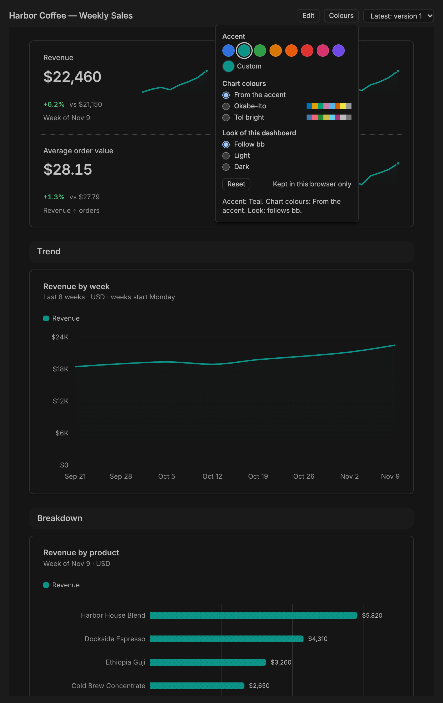
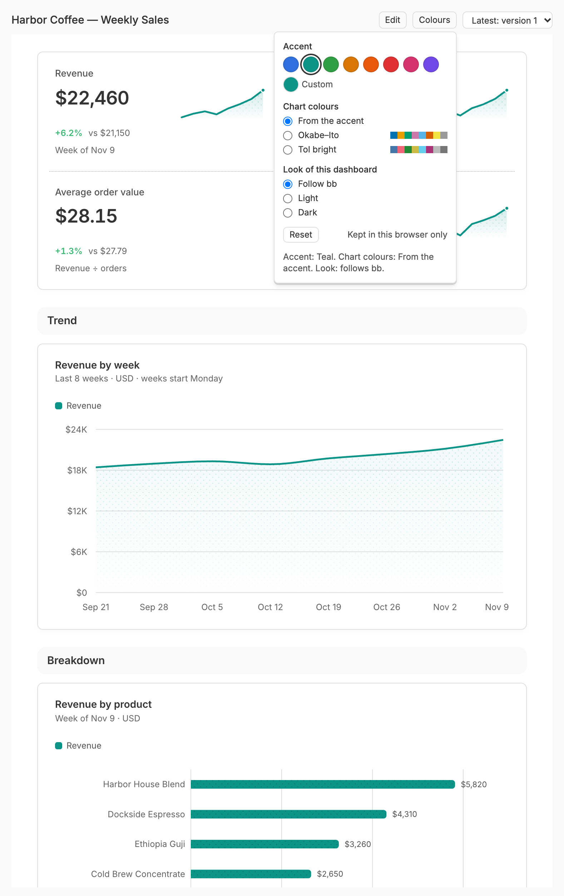
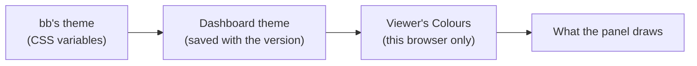

# Themes and colours

A dashboard's look comes from three layers. By default it follows bb's own theme, in light and dark mode. The agent can give a dashboard its own theme when it saves it, such as "make it dark green", which becomes a new version. And whoever is looking at the dashboard can pick an accent, chart colours and a light or dark look with the Colours button in its header, which is kept in that browser only and costs no model call. Each layer sits on top of the one before. This page explains the three layers and how they combine.

<!-- SCREENSHOT colours-dark.png (the picture is ready at screenshots/colours-dark.png): a dashboard in bb's side panel, dark mode, with the Colours popover open from its header: the Teal accent picked and "Chart colours" on "From the accent", the charts behind it drawn from the teal accent. Rules for a replacement: about 1,580 px wide (at least 1,200), PNG under 2 MiB, stock bb theme, invented data only, no thread list or project name. To show it, add this line here:  and, if you want it, this caption on its own line: *The Colours popover in dark mode: Teal accent, chart colours from the accent.* -->

<!-- SCREENSHOT colours-light.png (the picture is ready at screenshots/colours-light.png): the same dashboard and popover as colours-dark.png in light mode, Teal accent and "From the accent" chart colours. Same rules. To show it, add this line here:  and, if you want it, this caption on its own line: *The same choices in light mode.* -->

## Layer 1: bb's theme (the default)

Without a theme of its own, a dashboard takes bb's colours. The plugin points OpenUI's dashboard tokens at bb's CSS variables, so the dashboard follows bb when it switches between light and dark mode.

| Dashboard token | bb variable |
| --- | --- |
| `page` | `--background` |
| `surface` | `--card` |
| `surfaceSubtle` | `--muted` |
| `border`, `grid` | `--border` |
| `borderStrong` | `--input` |
| `ink` | `--foreground` |
| `inkSecondary` | `--muted-foreground` |
| `inkMuted` | `--subtle-foreground` |
| `accent` | `--primary` |
| `accentInk` | `--primary-foreground` |
| `good` | `--success` |
| `bad` | `--destructive-text` |
| `warning` | `--warning-text` |
| `radius` | `--radius` |

bb has no chart palette of its own, so the plugin builds the first chart colours from bb's theme colours. Which ones depends on whether bb's main colour (`--primary`) is a colour or a grey:

| Chart colour | bb's main colour is a colour | bb's main colour is grey (bb's stock theme) |
| --- | --- | --- |
| `series1` | `--primary` | `--timeline-accent` (bb's blue accent) |
| `series2` | `--timeline-accent` | `--pr-merged` |
| `series3` | `--pr-merged` | `--attention` |
| `series4` | `--attention` | the library's own |
| `series5` to `series8` | the library's own | the library's own |

- "Grey" means the main colour, as the browser resolves it, has an OKLCH chroma below 0.04 (`NEUTRAL_CHROMA` in `ui/colours.tsx`). bb's stock main colour has a chroma of 0, so its charts start from the blue accent instead of a grey line.
- If the main colour cannot be resolved, the first column applies. If the theme has no `--timeline-accent`, the first chart colour is the library's own.
- The panel checks again whenever bb switches mode or palette. Only the colours change; the dashboard is not redrawn from scratch.
- The `accent` token (focus rings, selections) is bb's main colour in both cases.

The sequential and diverging ramps keep the library's own colours. The font is bb's own sans-serif font. The mapping is `BB_THEME` in `ui/panel.tsx` and `bbSeries` in `ui/colours.tsx`. A dashboard's own theme and the viewer's Colours choices both sit on top of it and win.

## Layer 2: the dashboard's own theme

The agent can save a theme with the dashboard (`dashboard_save`'s `theme`):

```text
{light: {accent: "#1f6f43", series1: "#2a9d8f", radius: "6px"}, dark: {accent: "#5fd39a"}, font: "serif"}
```

- Every part is optional. `light` applies to both modes when `dark` is left out.
- Keys must be OpenUI dashboard token names. There are 88: colours, chart palettes, sequential and diverging ramps, status colours, radii, spacing and shadows. Most looks need only `accent`, `series1` to `series8`, `page`, `surface`, `ink` and `radius`. A name that is not a token is refused.
- A value is a CSS colour, length or shadow of at most 120 characters, made only of letters, digits, spaces and `#%(),./-`, with no `url(`. So a theme cannot load anything.
- `font` is `sans` (`system-ui, sans-serif`), `serif` (`ui-serif, serif`) or `mono` (`ui-monospace, monospace`). These are generic families, so the browser never fetches a font. Left out, bb's own font.
- Left out of a later save, the current theme is kept. `null` returns the dashboard to bb's theme.
- A theme change is saved as a new version, like any other change. The agent's guide for this is the `themes` topic (see [agents.md](agents.md)).

The 88 tokens: `sheenPeak`, `skelLineTone`, `skelBlockTone`, `page`, `surface`, `surfaceSubtle`, `border`, `borderStrong`, `ink`, `inkSecondary`, `inkMuted`, `grid`, `accent`, `accentInk`, `series1` to `series8`, `mutedMark`, `seq1` to `seq9`, `seqInk1` to `seqInk9`, `areaWash`, `areaDot`, `areaStackTop`, `areaStackBottom`, `areaStackTex`, `texTint`, `texInk`, `barInk`, `div1` to `div9`, `divInk1` to `divInk9`, `good`, `goodMark`, `bad`, `badMark`, `warning`, `warningSoft`, `warningMark`, `info`, `neutralSoft`, `mapLand`, `radius`, `radiusMd`, `radiusSm`, `spaceXs`, `spaceSm`, `spaceMd`, `spaceLg`, `spaceXl`, `space2xl`, `shadow`, `shadowPop`.

## Layer 3: the viewer's Colours control

Every dashboard's header has a Colours button. Its choices apply at once, to that dashboard only:

- Accent: eight swatches (Blue, Teal, Green, Amber, Orange, Red, Pink, Purple) or a custom colour picker.
- Chart colours: "From the accent" (the default), or one of two fixed palettes chosen to stay distinguishable for common kinds of colour blindness: Okabe–Ito (with grey in place of its black, which would vanish on a dark surface) and Tol bright (with a darker grey as its eighth colour).
- Look of this dashboard: "Follow bb", "Light" or "Dark".
- Reset forgets every choice for that dashboard.

What the choices change:

- The accent, adjusted only as far as needed to keep a 3:1 contrast against the card surface, and the text drawn on it (black or white, whichever contrasts more).
- Chart colours 1 to 8: from a fixed palette, or from the accent (the accent itself, then seven hues spread around the colour wheel from it). "From the accent" leaves the dashboard's own chart colours in place until you pick an accent. A fixed palette keeps its published colours unless one would nearly vanish into the surface (below 2:1 contrast), in which case it is darkened or lightened just enough.
- The sequential ramp (nine steps from near the surface to the accent and a little past it), used by heatmaps and treemaps, when an accent is picked.
- A look that differs from bb's current mode uses the library's own colours for that mode, with bb's corner radius, because bb's variables hold bb's current mode.

Not changed, on purpose or because the library draws them itself: the good, bad and warning colours, the diverging ramp, map land and a few fixed textures inside the charts. The contrast adjustments assume a white card in light mode and a dark grey card (#1e1e1e) in dark mode, not the real card colour.

The choices are stored in the browser's local storage on that device, one entry per dashboard. They create no version, make no model call, and do not reload the dashboard or fetch its data again. Deleting the dashboard from the Dashboards page removes the entry in that browser.

## How the layers combine



For each mode, the panel starts from bb's mapping, lays the dashboard's own theme over it (its `dark` part, or its `light` part when there is no `dark`), then lays the viewer's choices over that. A later layer wins token by token: a dashboard theme that sets only `radius` still follows bb's colours, and a viewer accent changes only the tokens listed above.

A Frame's own HTML gets the result as `var(--ink)`, `var(--muted)`, `var(--accent)`, `var(--border)` and `var(--surface)`. When the colours or the mode change, the new values are sent into the frame without reloading it.

## Related pages

- [components.md](components.md): the components these colours apply to.
- [editing.md](editing.md): changing the dashboard's own theme by asking.
- [limits.md](limits.md#colours-and-themes): colour limits in one list.
